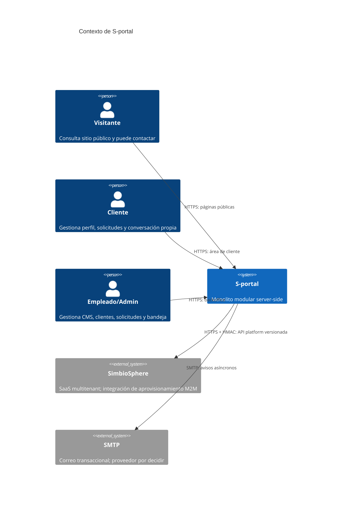
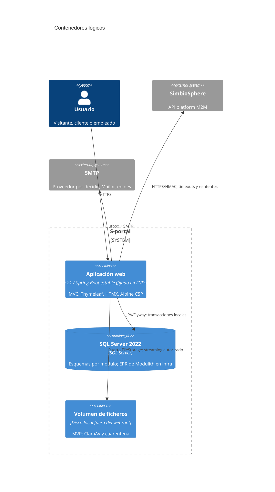
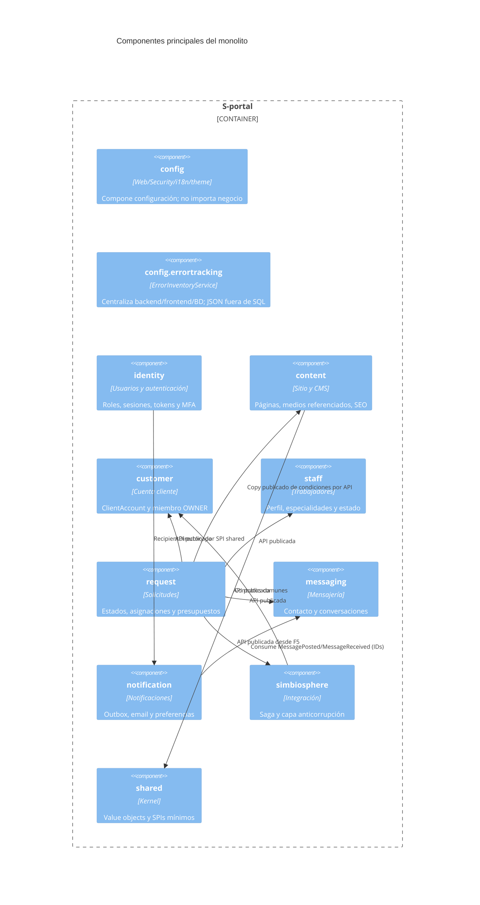
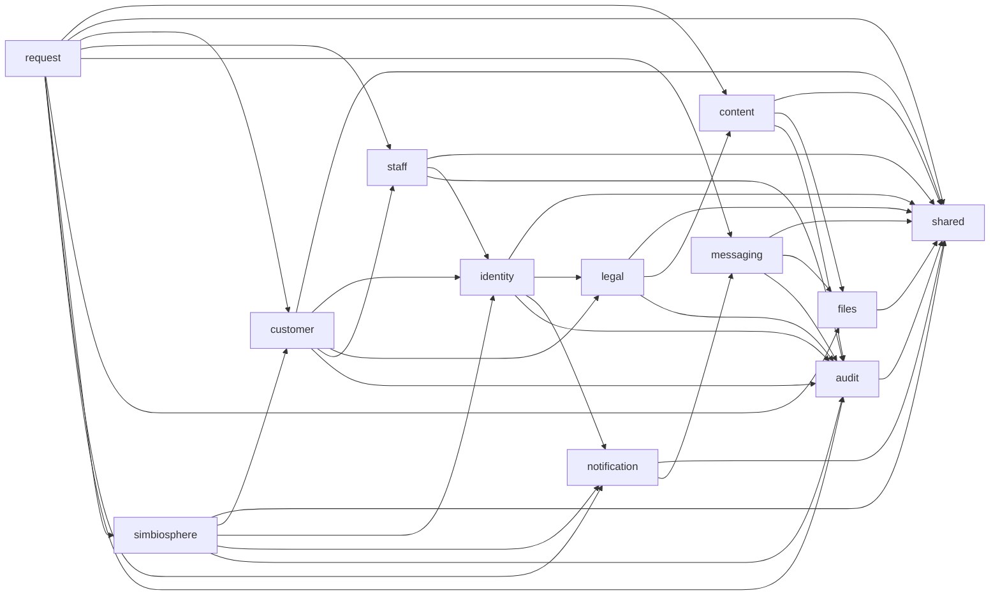

# 03 — Arquitectura

## Decisiones de diseño
S-portal es un monolito modular Spring Boot/Thymeleaf, un desplegable y una BD SQL Server. `com.simbio.core` es el `groupId` y paquete raíz confirmados por el owner; `artifactId` provisional: `portal` (validar el build en FND-002). La integración de SimbioSphere es HTTP M2M; no hay acceso a su BD, scraping ni transacción distribuida. Este documento define el objetivo; la implementación observable y sus límites se registran en [INVENTARIO.md](../../INVENTARIO.md). NTF/IAM de PROMPT 09 tienen código, aún sin validación Maven.

## C4 — Contexto

## C4 — Contenedores

## C4 — Componentes principales

Nota: la línea `content→notification` no es una dependencia Java; la composición se realiza por contrato y no debe implementarse como llamada directa. `config` compone SPI de navegación y seguridad sin importar módulos de negocio.

## Catálogo de módulos
Las flechas en la columna «Depende de» indican dependencias Java permitidas hacia interfaces `api` o SPI, nunca repositorios/entidades ajenas. Cada módulo publica `api` como named interface.

| Módulo | Responsabilidad / API publicada | Eventos | Tablas owner (propuesta) | Depende de |
|---|---|---|---|---|
| `audit` | Registro inmutable; `AuditRecorder`; implementa `shared.spi.AuditEventRecorder` | ninguno | `audit.audit_entry` | `shared` |
| `files` | Puerto `FileStorage`, metadata y escaneo | ninguno | `files.file_metadata`, `files.file_variant` | `shared` |
| `notification` | `EmailSender`, SMTP, plantillas y worker de outbox | consume eventos de dominio por API Modulith; no publica PII | `notification.outbox_message` (implementada); preferencias futuras | `shared`, `messaging` (API de eventos) |
| `content` | CMS, render, SEO y páginas públicas | `PagePublished` (IDs) | `content.page`, `page_translation`, `content_block`, `page_version`, `team_member`, `legal_document_version`, `slug_redirect` | `shared`, `files`, `audit` |
| `legal` | Consentimientos, derechos, retención | `DataSubjectErasureRequested` | `legal.consent_record`; `data_subject_request` y `retention_policy` propuestos | `shared`, `content`, `audit` |
| `identity` | Usuarios, autenticación, permisos, tokens, MFA y perfil | `ClientRegistered`, `EmailVerified`, `InvitationAccepted` (IDs) | `identity.user_account`, `role`, `permission`, `one_time_token`, `mfa_factor` | `shared`, `legal`, `notification`, `audit` |
| `customer` | ClientAccount, miembros, registro, invitaciones y directorio administrativo | `ClientRegistered` (IDs); consume `InvitationAccepted` (IDs + referencia opaca) | `customer.client_account`, `account_member`, `client_invitation` | `shared`, `identity`, `legal`, `staff`, `audit` |
| `staff` | Perfil, especialidades y estado de trabajador | consume `InvitationAccepted` | `staff.staff_profile`, `staff_specialty` | `shared`, `identity`, `audit` |
| `simbiosphere` | Saga, API M2M y vínculos externos | `ProvisioningStateChanged` (IDs) | `simbiosphere.provisioning`, `account_link`, `linked_business` | `shared`, `customer`, `identity`, `notification`, `audit` |
| `messaging` | Conversaciones CONTACT/REQUEST, mensajes y visibilidad; API consumida por `request` | publica `MessagePosted`/`MessageReceived` con IDs únicamente | `messaging.conversation`, `message`, `message_attachment`, `thread_access_token` | `shared` (SPI mínimo de ownership), `files`, `audit` |
| `request` | Solicitudes, asignación, estados y presupuestos | `RequestCreated`, `RequestStatusChanged`, `RequestAssigned`, `QuoteSent`, `QuoteDecisionMade`, `QuoteExpired` (IDs/estado) | `request.request`, `request_assignment`, `request_attachment`, `request_status_history`, `reference_counter`, `request_category`, `quote`, `quote_version` | `shared`; APIs `customer`, `messaging`, `files`, `audit`, `staff`, `notification`. PROMPT 13 usa outbox por `notification.api`; `request` no importa repositorios/entidades ajenos |
| `shared` | Kernel mínimo y SPIs (`CurrentUser`, `RecipientDirectory`, `ThemePreference`, `LocalePreference`, `SensitiveDataProtector`, `AntiBotVerification`, `PersonalDataContributor`, `ClientAccountOwnership`, `NavContribution`, `ErrorReporter`, `AuditEventRecorder`) | n/a | ninguna | ninguno; OPEN |
| `config` | Web, security, i18n, tema, rate limit, anti-bot, observabilidad, `ErrorInventoryService` y visor ADMIN | n/a | ninguna; inventario JSON externo a SQL | `shared`; OPEN, sin dependencia de negocio |

`site` se integra en `content`; presupuestos son parte del agregado `request`; `staff` y `customer` conservan owners distintos. No se crean módulos vacíos.

Estado local PROMPT 15: el módulo `simbiosphere` ya existe como owner de `provisioning`, `account_link` y `linked_business`. Consume `customer.api` por UUID, expone contratos/eventos en `simbiosphere.api` y no contiene todavía transporte HTTP aprobado ni dependencias Java hacia DEMO. `request→simbiosphere` continúa sin añadirse hasta SIM-014.

Para evitar el ciclo `customer → identity → notification → messaging → customer`, `messaging` valida si un CLIENT conserva una cuenta OWNER activa mediante el SPI `shared.spi.ClientAccountOwnership`; su adapter consulta exclusivamente el almacenamiento propio de `customer`. Los eventos permanecen en `messaging::api`, y `notification` podrá consumirlos en su propio sentido de dependencia. El DAG no incluye una llamada de `messaging` a `customer`.

PROMPT 09 añade código a `notification`, `identity` y `config`; PROMPT 10 añade código parcial a `legal` y `customer`. La última verificación Java 21 `verify -Plocal-h2` pasó 371 tests Surefire y 34 Failsafe H2 (un test opt-in omitido), sin fallos ni errores y con JaCoCo aprobado; `messaging.domain` tiene 100% de cobertura de líneas. La regla ArchUnit de shared/config solo incluye los paquetes transversales `com.simbio.core.shared..` y `com.simbio.core.config..`, además del fixture negativo de shared; los paquetes `config` internos a un módulo no se clasifican como configuración global. `/registro` usa el servicio anti-bot local y alta de identidad, consentimiento y cuenta; `/gestion/clientes/nuevo` crea la cuenta tras la aceptación de invitación. `identity` ofrece listados separados y paginados de invitaciones pendientes de clientes y trabajadores, con reenvío acotado por permiso y rotación de token. El proof-of-work/honeypot no usa la biblioteca/protocolo oficial ALTCHA y su replay guard no coordina réplicas. Las invitaciones customer retienen metadatos cifrados sin caducidad/limpieza propia. LGL-002/003 continúan pendientes: faltan contributors de todos los owners, aprobación de anonimización y plazos de retención. El MFA es obligatorio para ADMIN y los usuarios EMPLOYEE pueden optar por enrolarse; el login desafía a cualquier usuario con factor activo. Ver [INVENTARIO.md](../../INVENTARIO.md) para el estado y las limitaciones.

## DAG de dependencias

El grafo es acíclico. `audit` y `files` son hojas de negocio que solo dependen de `shared`. `notification` consume el API de eventos de `messaging`; no depende de `request`. Cuando `request` publica un evento de dominio, su adapter de aplicación traduce ese hecho a `notification.api.RequestNotificationRequested` sin entidad/PII y conserva la clave idempotente; `notification` consume únicamente ese contrato y `request` mantiene la consulta de owner/ruta como dato propio. `config` usa `shared` y no aparece como dependencia de negocio.

## Capas, paquetes y datos
- Cada módulo vive bajo `com.simbio.core.<module>`; raíz con `package-info.java` y `@ApplicationModule(allowedDependencies=...)`.
- `api`: contratos/eventos/DTO públicos y `@NamedInterface("api")`; no depende de `web` ni `infrastructure`.
- `application`: casos de uso, transacciones locales y puertos; `domain`: entidades JPA, invariantes y value objects; `infrastructure`: adaptadores; `web`: MVC/Thymeleaf/HTMX, sin repositorios.
- Reglas ArchUnit: `web→application→domain`; infraestructura implementa puertos; controladores no acceden a repositorios; cada tabla tiene un owner y esquema SQL propio.
- Comunicación síncrona solo por `api`; comunicación asíncrona vía Spring Modulith Event Publication Registry (EPR). Eventos contienen IDs, no PII, credenciales ni tokens. Esquema EPR: `infra`.

## Composición frontend
- Plantillas de módulo en `templates/<module>/`; fragmentos compartidos en `templates/fragments/`; layouts `public`, `account`, `backoffice`.
- Composición inter-módulo por fragmentos HTMX URL con permiso propio en cada endpoint; nunca por import Java de plantillas/repositorios. Menú por `shared.spi.NavContribution` compuesto en `config`.
- Tailwind CLI y assets locales con huella; HTMX y Alpine CSP locales; JavaScript mínimo por componente. Tokens CSS semánticos, sin colores directos en plantillas.
- Bundles `i18n/<module>/messages_{es,en}.properties`; páginas públicas `/{lang}/...`, áreas privadas `/cuenta/...` y `/gestion/...`. CSP nonce, CSRF HTMX, tema claro/oscuro y mejora progresiva son transversales.

## Límites
- `config` no es módulo de negocio: seguridad, web, i18n, tema, observabilidad y rate limiting.
- `config.errortracking.ErrorInventoryService` centraliza errores recibidos por `shared.spi.ErrorReporter`, handlers, aspecto DB y endpoint frontend. Persistir fuera de SQL permite registrar indisponibilidad de la BD; `/error` es un adaptador de despacho, no el registrador central.
- El inventario operativo `logs-error/error-inventory.json` queda fuera del webroot y no pertenece a ningún esquema SQL. Persistencia multi-réplica, volumen y retención deben confirmarse antes de escalar.
- Actuator se recomienda en management port separado `8091`, accesible solo por red/probes internas y no publicado; exponer únicamente health/readiness y métricas autorizadas. Confirmar configuración Boot 4/plataforma en FND-001/FND-010.
- No hay llamada HTTP a DEMO dentro de transacción local. La saga y estados se detallan en [05-integracion-simbiosphere.md](05-integracion-simbiosphere.md).
- Contratos UI, permisos, tablas y módulos detectados se reflejan en [04-modelo-datos.md](04-modelo-datos.md), [06-ux-ui.md](06-ux-ui.md) y el inventario planificado en [12-gobernanza-modular.md](12-gobernanza-modular.md).
