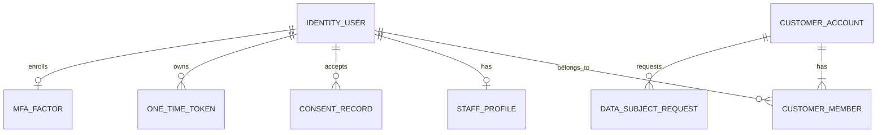
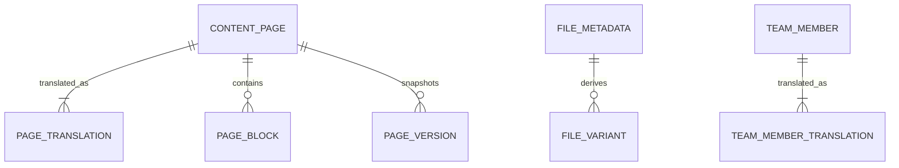
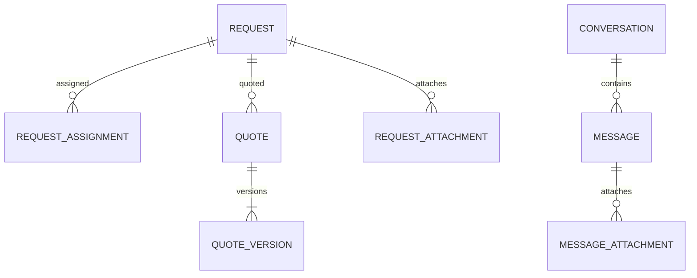
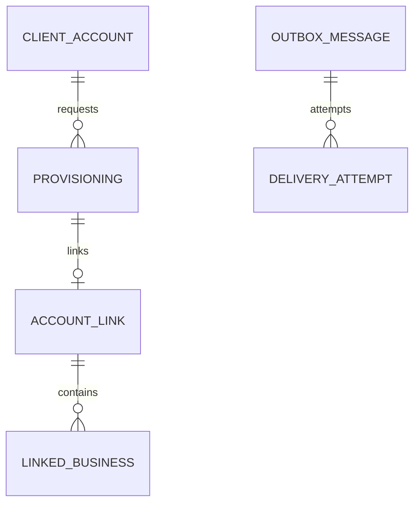

# 04 — Modelo de datos

## Convenciones comunes
SQL Server 2022; una base y esquema por módulo. Clave interna `BIGINT IDENTITY` como clustered PK; `public_id UNIQUEIDENTIFIER` (UUIDv4 generado por aplicación) con índice único no clustered para URLs. No exponer claves secuenciales. Fechas `datetime2(3)` UTC (`*_at`); textos `NVARCHAR`; importes `DECIMAL(19,4)` y `currency CHAR(3)` ISO; colación propuesta `Latin1_General_100_CI_AS_SC` (**VERIFICAR** en FND-001). Timestamps se escriben en UTC y se presentan en `Europe/Madrid` o locale elegido.

No se crean relaciones JPA ni escrituras entre esquemas de módulos. Referencias a owners externos son IDs/public IDs resueltos mediante `api`; FKs se limitan al esquema propietario. Los nombres/columnas son propuesta y se fijan en las migraciones de cada tarea.

## Identidad, cuenta, personal y legal


| Esquema.tabla (owner) | Columnas principales | Restricciones/índices |
|---|---|---|
| `identity.user_account` | `id`, `public_id`, `email_normalized NVARCHAR(320)`, `first_name`, `last_name`, `password_hash NVARCHAR(255)`, `status`, `email_verified_at`, `preferred_locale`, `created_at` | PK clustered; `public_id` único; email normalizado único; no persistir password en claro |
| `identity.user_role` / `identity.role_permission` | `user_id`, `role_code`, `permission_code`, `created_at` | Unicidad por asignación; cambios privilegiados auditados |
| `identity.one_time_token` | `user_id`, `purpose`, `token_hash VARBINARY`, `expires_at`, `consumed_at`, `revoked_at` | Índice único hash; consumo atómico de un uso; token en claro nunca se almacena |
| `identity.mfa_factor` | `user_id`, `secret_ciphertext`, `enabled_at`, `last_used_step` | Un factor activo por usuario; secreto cifrado/versionado |
| `customer.client_account` | `id`, `public_id`, `account_type`, `display_name`, `legal_name`, `tax_id_ciphertext`, `country_code`, `status`, timestamps | `account_type` empresa/autónomo/particular; NIF opcional al alta; datos fiscales cifrados |
| `customer.account_member` | `client_account_id`, `user_id`, `role_code`, `status`, `joined_at` | Un OWNER activo por cuenta en MVP; preparado para `MEMBER` futuro; referencias identity por API/ID |
| `staff.staff_profile` | `id`, `public_id`, `user_id`, `job_title`, `phone_ciphertext`, `employment_status`, timestamps | `user_id` único; no contraseña propia; alta vinculada a invitación |
| `staff.staff_specialty` | `staff_profile_id`, `specialty_code` | Único por perfil/especialidad; catálogo configurable |
| `legal.consent_record` | `id`, `subject_user_id`, `consent_type`, `document_version_id`, `accepted_at`, `source`, `ip_ciphertext` | Versión/fecha/origen obligatorios; índice por sujeto/tipo/fecha |
| `legal.data_subject_request` | `id`, `public_id`, `subject_user_id`, `request_type`, `status`, `requested_at`, `completed_at` | Estado auditable; exportación temporal con expiración; no contener payload sin cifrar |
| `legal.retention_policy` | `data_category`, `retention_days`, `action`, `effective_from`, `approved_by` | Política versionada; no ejecutar borrado irreversible antes de aprobación |

## Contenido, ficheros y auditoría


| Esquema.tabla (owner) | Columnas principales | Restricciones/índices |
|---|---|---|
| `content.page` | `id`, `public_id`, `content_type`, `publication_state`, `created_by`, timestamps | Índice por state/type; `content` único owner |
| `content.page_translation` | `page_id`, `locale`, `slug`, `title`, `description`, `published_at` | Único `(page_id, locale)` y `(locale, slug)`; guardar slug anterior para 301 |
| `content.page_block` | `page_id`, `locale`, `block_type`, `sort_order`, `content_json` | `block_type` allowlist; validar JSON y contenido saneado |
| `content.page_version` | `page_id`, `version_no`, `snapshot`, `author_id`, `published_at` | Único `(page_id, version_no)`; snapshots inmutables; diff completo R2 |
| `content.team_member` / `team_member_translation` | `public_id`, `publication_state`; `locale`, `name`, `role`, `bio`, `alt`, `file_public_id` | Locale único; solo medios CLEAN; derechos de imagen verificados |
| `content.legal_document_version` | `document_type`, `locale`, `version`, `valid_from`, `valid_to`, `body_sanitized` | Único `(document_type, locale, version)`; documento aprobado antes de publicar |
| `content.slug_redirect` | `locale`, `old_slug`, `new_slug`, `created_at` | `old_slug` único por locale; 301 solo entre rutas públicas |
| `files.file_metadata` | `id`, `public_id`, `storage_key`, `detected_mime`, `size_bytes`, `scan_state`, `created_at` | `storage_key` único y aleatorio; `size_bytes` acotado; `scan_state` bloquea cuarentena |
| `files.file_variant` | `file_id`, `variant_code`, `storage_key`, `width`, `height`, `mime` | Único `(file_id, variant_code)`; límite de píxeles/tamaño |
| `audit.audit_entry` | `id`, `actor_id`, `action_code`, `entity_type`, `entity_public_id`, `occurred_at`, `correlation_id`, `before_hash`, `after_hash` | Índices por entidad/fecha y actor/fecha; sin contenido PII/secretos |

## Solicitudes y mensajería


| Esquema.tabla (owner) | Columnas principales | Restricciones/índices |
|---|---|---|
| `request.request` | `id`, `public_id`, `reference_code`, `client_account_id`, `request_type`, `category_code`, `state_code`, `priority`, `created_at`, `updated_at` | `reference_code` único `SOL-AAAA-NNNNNN`; índices `(owner,state)` y fecha; sin descarga server-side de URLs |
| `request.assignment` | `request_id`, `staff_user_id`, `assignment_role`, `assigned_at`, `ended_at` | Una asignación responsable activa por solicitud; referencias a staff por API/ID |
| `request.status_history` | `request_id`, `from_state`, `to_state`, `actor_id`, `occurred_at`, `public_visibility`, `reason_code` | Append-only; índices por request/fecha |
| `request.quote` / `quote_version` | `request_id`, `state`, `version_no`, `amount DECIMAL(19,4)`, `currency CHAR(3)`, `vat_rate`, `valid_until`, `tax_id_snapshot_ciphertext` | Versionado append-only; estados DRAFT/SENT/ACCEPTED/REJECTED/EXPIRED; no pagos MVP |
| `request.request_attachment` | `request_id`, `file_public_id`, `added_by`, `added_at` | Owner de relación request; bytes/metadatos owner files |
| `messaging.conversation` | `id`, `public_id`, `context_type`, `context_public_id`, `owner_user_id`, `status`, `assigned_to`, `created_at` | Contexto CONTACT/REQUEST; índices por owner/estado y asignación |
| `messaging.message` | `conversation_id`, `author_id`, `author_type`, `visibility`, `body`, `created_at`, `read_at` | `visibility` PUBLIC/INTERNAL; índices cronológicos; consultas CLIENT filtran INTERNAL en SQL/application |
| `messaging.message_attachment` | `message_id`, `file_public_id`, `created_at` | Relación local; descarga pasa autorización por conversación y FileStorage |
| `messaging.thread_access_token` | `conversation_id`, `token_hash`, `expires_at`, `consumed_at`, `revoked_at` | Hash único, TTL, scope a un hilo y consumo atómico |

## Notificación e integración


| Esquema.tabla (owner) | Columnas principales | Restricciones/índices |
|---|---|---|
| `notification.outbox_message` | `id`, `public_id`, `event_type`, `payload_ciphertext`, `status`, `attempt_count`, `next_attempt_at`, `created_at` | Claim por estado/fecha; payload cifrado; idempotency key único por operación |
| `notification.delivery_attempt` | `outbox_id`, `attempt_no`, `result_code`, `attempted_at` | Único `(outbox_id, attempt_no)`; sin correo/body en logs |
| `notification.notification_preference` | `user_id`, `category`, `enabled`, `updated_at` | Único `(user_id, category)`; consentimiento comercial separado |
| `simbiosphere.provisioning` | `id`, `public_id`, `client_account_id`, `state`, `attempt_count`, `locked_until`, `next_attempt_at`, IDs DEMO, timestamps | Índices por state/next_attempt y owner; lease para workers concurrentes |
| `simbiosphere.account_link` | `client_account_id`, `external_system`, `external_account_id`, `external_owner_user_id`, `status` | Único `(external_system, external_account_id)`; jamás unique por email |
| `simbiosphere.linked_business` | `account_link_id`, `tenant_id`, `tenant_slug`, `location_id`, `status` | Permite varios tenants por cuenta |
| `infra.event_publication` | columnas del Event Publication Registry de Spring Modulith | Esquema `infra`; compatibilidad SQL Server/Flyway **VERIFICAR** en FND-001 |

## Relaciones, restricciones e índices
- Las FKs internas se crean dentro del esquema owner. IDs externos a módulo se resuelven por `api`; no se importan entidades JPA de otro módulo. El vínculo de negocio se valida en servicio y la autorización comprueba rol **y** propiedad del recurso.
- Índices mínimos: identidad por email normalizado; CMS por `(locale, slug, state)`; request por `(client_account_id, state_code, created_at)`; inbox por `(status, assigned_to, created_at)`; quote por `(request_id, version_no)`; outbox por `(status, next_attempt_at)`; provisioning por `(state, next_attempt_at, locked_until)`.
- Todas las pruebas automatizadas de persistencia usan H2. Collation, secuencias de `SOL-AAAA-NNNNNN`, índices filtrados, nivel de aislamiento y demás comportamiento específico de SQL Server no se verifican; se mantiene como riesgo conocido y no se afirma compatibilidad probada con producción.
- Email/nombres/textos que requieren búsqueda se protegen mediante edición/TDE, cifrado de disco y backups según ADR-009/006 (**VERIFICAR edición soportada**). `tax_id`, teléfono, TOTP, IP si se conserva y payload de email se cifran por columna; tokens siempre hasheados.

## Migraciones
Único árbol Flyway para SQL Server:

```text
db/migration/<module>/V<yyyyMMddHHmm>__<module>__<descripcion>.sql
```

Cada migración crea/actualiza solo el esquema owner; se mantiene un único árbol Flyway dirigido a SQL Server y no se crean migraciones H2. Las pruebas H2 usan esquema generado y no ejecutan ni certifican las migraciones SQL Server. El test estático de nomenclatura valida prefijo, esquema, tipos comunes y ausencia de `dbo`; no valida sintaxis/dialectos. `clean-disabled=true`, baseline explícito y migraciones forward-only. La compatibilidad de ejecución de Flyway sobre SQL Server y el esquema EPR queda sin verificar.

## Inventario operativo de errores (no relacional)
El inventario central se persiste en `logs-error/error-inventory.json`, en directorio de datos privado montado como volumen, fuera del webroot. **No se guarda en SQL Server**: un error de conexión/esquema de la BD debe poder registrarse sin depender de esa misma BD. El servicio `config.errortracking.ErrorInventoryService` mantiene entradas deduplicadas por huella con fuente (BACKEND/FRONTEND/DATABASE), severidad, primera/última ocurrencia, contador, estado de resolución y contexto permitido.

El formato JSON no es una tabla ni tiene owner de dominio. El escritor debe usar lock y reemplazo atómico, validar/cargar con recuperación controlada y aplicar límite de tamaño/caducidad. En despliegue de una instancia, volumen persistente y backup según [ADR-012](../adr/ADR-012-inventario-operativo-de-errores.md); varias réplicas requieren single-writer o storage coordinado aprobado antes de producción. Errores SQL se registran con metadatos saneados; no se persiste mensaje raw del driver, parámetros ni payload.

## Decisiones pendientes
La estrategia `BIGINT IDENTITY + public_id UUIDv4`, collation, edición SQL Server, TDE, cifras de retención y campos obligatorios de cuenta se fijan mediante [ADR-004](../adr/ADR-004-estrategia-de-ids-sql-server.md), [ADR-006](../adr/ADR-006-despliegue-y-licencia-sql-server.md) y [ADR-009](../adr/ADR-009-cifrado-de-pii.md). Las retenciones propuestas están en [07-seguridad-rgpd.md](07-seguridad-rgpd.md) y requieren aprobación legal antes de purgas.
