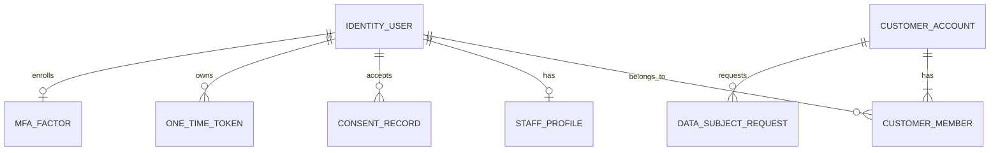
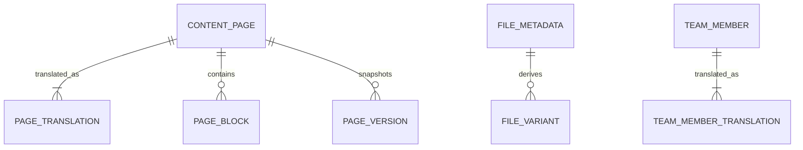
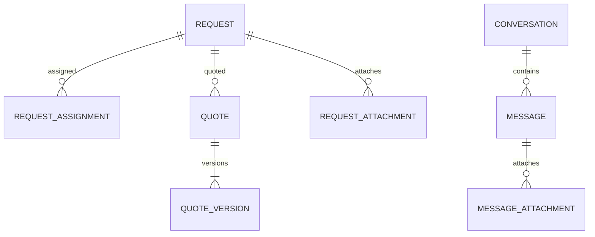
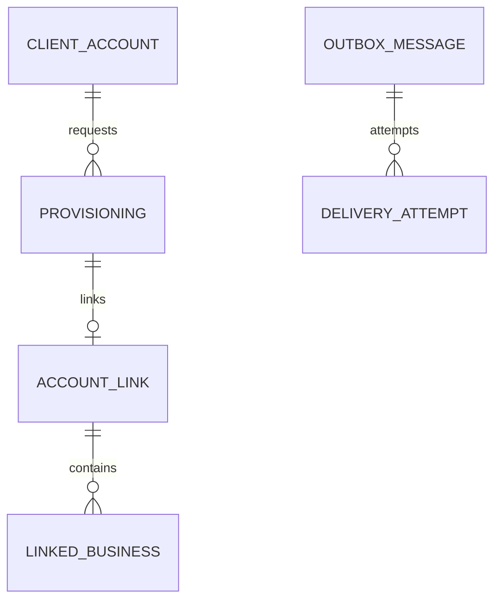

# 04 — Modelo de datos

## Convenciones comunes
SQL Server 2022; una base y esquema por módulo. Clave interna `BIGINT IDENTITY` como clustered PK; `public_id UNIQUEIDENTIFIER` (UUIDv4 generado por aplicación) con índice único no clustered para URLs. No exponer claves secuenciales. Fechas `datetime2(3)` UTC (`*_at`); textos `NVARCHAR`; importes `DECIMAL(19,4)` y `currency CHAR(3)` ISO; colación propuesta `Latin1_General_100_CI_AS_SC` (**VERIFICAR** en FND-001). Timestamps se escriben en UTC y se presentan en `Europe/Madrid` o locale elegido.

No se crean relaciones JPA ni escrituras entre esquemas de módulos. Referencias a owners externos son IDs/public IDs resueltos mediante `api`; FKs se limitan al esquema propietario. Los nombres/columnas son propuesta y se fijan en las migraciones de cada tarea.

## Identidad, cuenta, personal y legal


| Esquema.tabla (owner) | Columnas principales | Restricciones/índices |
|---|---|---|
| `identity.user_account` | `id`, `public_id`, `email_normalized NVARCHAR(320)`, `first_name`, `last_name`, `display_name`, `password_hash NVARCHAR(255)`, `status`, `email_verified_at`, `preferred_locale`, `theme_preference`, `created_at` | PK clustered; `public_id` único; email normalizado único; tema NULL o `light`/`dark`; no persistir password en claro |
| `identity.user_role` / `identity.role_permission` | `user_id`, `role_code`, `permission_code`, `created_at` | Unicidad por asignación; cambios privilegiados auditados |
| `identity.one_time_token` | `id`, `token_hash CHAR(64)`, `purpose`, `user_public_id`, `email_encrypted`, `email_key CHAR(64)`, `role_code`, `expires_at`, `consumed_at`, `revoked_at`, `created_at` | Hash único; `email_key` es HMAC-SHA-256 ciego con separación de propósito y clave; propósitos limitados; rol CLIENT/EMPLOYEE requerido para invitación; consumo atómico; token en claro nunca se almacena |
| `identity.mfa_factor` | `user_public_id`, `secret_encrypted`, `enabled`, `last_accepted_step`, `recovery_hashes`, `updated_at`, `version` | Un factor por usuario; secreto cifrado; códigos de recuperación hashados; referencia FK al usuario |
| `customer.client_account` | Código presente: `id`, `public_id`, `account_type`, `display_name`, `status`, `created_at`; opcionales `country_code`, `tax_id_ciphertext`, `phone_ciphertext` | `account_type`: `COMPANY`/`SOLE_TRADER`/`INDIVIDUAL`; NIF y teléfono opcionales; valores sensibles protegidos mediante `SensitiveDataProtector`; solo hay validador fiscal sintáctico `ES` |
| `customer.account_member` | `id`, `account_id`, `user_public_id`, `role_code`, `status_code`, `owner_slot`, `joined_at` | Un OWNER activo por cuenta; unicidad de usuario por cuenta; vínculo de identidad por UUID comprobado mediante API, sin FK/repositorio externo |
| `customer.client_invitation` | Código presente: `invitation_reference`, `account_type`, `account_name_ciphertext`, `created_by_user_id`, `status`, `created_at`, `accepted_user_id`, `client_account_public_id`, `completed_at` | Referencia opaca única; nombre cifrado; no persiste email/token; alta idempotente tras aceptación. No tiene expiración/limpieza propia |
| `staff.staff_profile` | `id`, `public_id`, `user_id`, `job_title`, `phone_ciphertext`, `employment_status`, timestamps | `user_id` único; no contraseña propia; alta vinculada a invitación |
| `staff.staff_specialty` | `staff_profile_id`, `specialty_code` | Único por perfil/especialidad; catálogo configurable |
| `legal.consent_record` | Implementado: `id`, `public_id`, `subject_user_id`, `purpose_code`, `document_type`, `document_locale`, `document_version`, `accepted_at`, `source_code` | Versión publicada vigente; hora UTC del servidor; actor autenticado debe coincidir con el sujeto; sin IP |
| `legal.data_subject_request` | Diseño objetivo; no hay tabla/migración implementada | Requiere contributors de todos los owners, exportación temporal protegida y aprobación antes de anonimización irreversible |
| `legal.retention_policy` | Diseño objetivo; no hay tabla/migración implementada | No hay política activa ni purga; solo dry-run hasta aprobación legal de categorías/plazos |

El esquema y las columnas de `customer` y `legal.consent_record` reflejan código/migraciones presentes, no un cierre validado. Las fuentes de tests Java compilaron, pero el runner no pudo iniciar Surefire por una dependencia Maven ausente del repositorio offline; no se ejecutaron tests H2. Las tablas de solicitudes RGPD y retención siguen siendo propuestas del modelo, no evidencia de implementación.

## Contenido, ficheros y auditoría


| Esquema.tabla (owner) | Columnas principales | Restricciones/índices |
|---|---|---|
| `content.page` | `id`, `public_id`, `page_key`, `page_type`, `created_at` | `page_key` y `public_id` únicos; `content` único owner |
| `content.page_translation` | `page_id`, `locale`, `slug`, title/SEO, `state_code`, `approval_state`, `published_slug`, immutable `published_snapshot_json`, version/author/timestamps | Único `(page_id, locale)` y `(locale, slug)`; índice filtrado por `(locale, published_slug)`; locale y estados allowlisted |
| `content.content_block` | `translation_id`, `block_type`, `position_no`, heading, Markdown, URL local/segura, `media_public_id` | Tipo allowlisted; posición única por traducción; las referencias de fichero no importan entidades de `files` |
| `content.page_version` | `translation_public_id`, `version_no`, `snapshot_json`, `actor_id`, `created_at` | Único `(translation_public_id, version_no)`; snapshots inmutables; diff completo R2 |
| `content.slug_redirect` | `locale`, `old_slug`, `new_slug`, `created_at` | `old_slug` único por locale; 301 solo entre rutas públicas |
| `content.media_asset` | `file_public_id`, `alt_es`, `alt_en`, `created_at` | Solo referencia y texto alternativo; MIME, tamaño, estado de escaneo y bytes pertenecen a `files` |
| `content.team_member` / `team_member_translation` | `public_id`, posición, estado activo/aprobación de materiales; `locale`, nombre, rol, bio Markdown, referencia/alt de foto, URL perfil | Locale único por miembro; solo CLEAN; aprobación de materiales sigue bloqueada hasta definir autoridad/proceso |
| `content.legal_document_version` | `document_type`, `locale`, `version_no`, título, Markdown, `approval_state`, `effective_from`, autor/fecha | Único `(document_type, locale, version_no)`; una versión futura o pendiente no es vigente |
| `files.file_metadata` | `id`, `public_id`, `storage_key`, `detected_mime`, `size_bytes`, `scan_state`, `created_at` | `storage_key` único y aleatorio; `size_bytes` acotado; `scan_state` bloquea cuarentena |
| `files.file_variant` | `file_id`, `variant_code`, `storage_key`, `width`, `height`, `mime` | Único `(file_id, variant_code)`; límite de píxeles/tamaño |
| `audit.audit_entry` | `id`, `actor_id`, `action_code`, `entity_type`, `entity_public_id`, `occurred_at`, `correlation_id`, `before_hash`, `after_hash` | Índices por entidad/fecha y actor/fecha; sin contenido PII/secretos |

## SimbioSphere y aprovisionamiento

| Esquema.tabla (owner) | Columnas principales | Restricciones/índices |
|---|---|---|
| `simbiosphere.provisioning` | `id`, `public_id`, `client_account_public_id`, `owner_user_public_id`, estado, `external_system`, IDs externos, datos de negocio/sede, módulos JSON opcionales, versión/fecha de términos, `idempotency_key`, error, intentos, lease/backoff y timestamps | Un provisioning por ClientAccount; `idempotency_key` y `public_id` únicos; estado limitado; `modules_json` NULL distingue defaults de `[]`; no guarda email, nombre personal, password ni token; lease y optimistic locking |
| `simbiosphere.account_link` | `id`, `public_id`, referencia `client_account_public_id`, sistema externo, `external_account_id`, `created_at` | Unicidad `(external_system, external_account_id)`; nunca resolver por email |
| `simbiosphere.linked_business` | `id`, `public_id`, FK al vínculo del mismo esquema, `external_business_id`, nombre/tipo/slug externo, `created_at` | FK solo dentro de `simbiosphere`; una cuenta puede tener 1..N negocios; no se asume un ownerUserId dentro del tenant externo |

Las referencias a `customer` son UUIDs resueltos por API y no crean FK cross-module. `request.request.linked_business_public_id` referencia `simbiosphere.api.LinkedBusinessQuery` por UUID, sin FK ni import de entidad entre módulos. La migración SQL Server no se ejecuta ni certifica mediante H2.

## Solicitudes y mensajería


| Esquema.tabla (owner) | Columnas principales | Restricciones/índices |
|---|---|---|
| `request.request` | Implementado: `id`, `public_id`, `reference_code`, `owner_account_id`, `owner_user_id`, `request_type`, `category_code`, campos de negocio, `status_code`, `priority_code`, `estimate_hours`, `first_response_at`, `created_at`, `version` | `reference_code` único `SOL-AAAA-NNNNNN`; prioridad allowlisted; estimate no negativo; índices owner/fecha, tipo/categoría y estado/fecha |
| `request.request_assignment` | Implementado: `request_id`, `staff_user_id`, `responsible`, `assigned_by`, `created_at` | Un staff por solicitud, un único responsable por índice filtrado, colaboradores 0..N; staff se valida por `staff.api` y se referencia solo por UUID |
| `request.request_status_history` | Implementado: `request_id`, `from_status`, `to_status`, `actor_id`, `reason`, `created_at` | Append-only; índice por request/fecha; solo estados públicos existen en el DTO cliente |
| `request.reference_counter` / `request_category` | Implementados: año/último número/versionado; categoría activa | Contador bloqueado por transacción para referencias UTC; categorías configurables por tabla owner |
| `request.quote` / `quote_version` | Implementado por PROMPT 13, pendiente de gates: quote público/request, versión, `DECIMAL(19,4)`, currency/tax/gross, validez, estado, actor/fechas y optimistic locking | Versionado único por quote; append-only tras envío/decisión; estados DRAFT/SENT/ACCEPTED/REJECTED/EXPIRED; no pagos. Fiscalidad y validez comercial siguen pendientes de aprobación |
| `request.request_attachment` | Implementado: `request_id`, `file_public_id`, `added_by`, `created_at` | Owner de relación request; bytes/metadatos owner files y descarga con ownership |
| `messaging.conversation` | `id`, `public_id`, `context_type`, `context_public_id`, `owner_user_id`, `status`, `assigned_to`, `created_at` | Contexto CONTACT/REQUEST; índices por owner/estado y asignación |
| `messaging.message` | `conversation_id`, `author_id`, `author_type`, `visibility`, `body`, `created_at`, `read_at` | `visibility` PUBLIC/INTERNAL; índices cronológicos; consultas CLIENT filtran INTERNAL en SQL/application |
| `messaging.message_attachment` | `message_id`, `file_public_id`, `created_at` | Relación local; descarga pasa autorización por conversación y FileStorage |
| `messaging.thread_access_token` | `conversation_id`, `token_hash`, `expires_at`, `consumed_at`, `revoked_at` | Hash único, TTL, scope a un hilo y consumo atómico |

El ownership CLIENT se valida mediante `shared.spi.ClientAccountOwnership`, implementado por customer; messaging no importa entidades ni repositorios de ese módulo. `MessagePosted` y `MessageReceived` contienen exclusivamente los UUID públicos de conversación y mensaje; los cuerpos se consultan mediante `messaging::api` con la política de visibilidad aplicada en persistencia.

## Notificación e integración


| Esquema.tabla (owner) | Columnas principales | Restricciones/índices |
|---|---|---|
| `notification.outbox_message` | `id`, `payload_encrypted`, `status`, `attempt_count`, `available_at`, `claimed_until`, `created_at`, `sent_at`, `failure_code` | Estados PENDING/PROCESSING/SENT/FAILED; índices de claim y purga; payload cifrado; no garantiza exactly-once |
| `notification.delivery_attempt` | Diseño futuro, no creado por NTF-001..003 | Requiere decisión antes de persistir detalle de intentos |
| `notification.notification_preference` | Diseño futuro, fuera de NTF-001..003 | Consentimiento comercial debe mantenerse separado |
| `simbiosphere.provisioning` | `id`, `public_id`, `client_account_id`, `state`, `attempt_count`, `locked_until`, `next_attempt_at`, IDs DEMO, timestamps | Índices por state/next_attempt y owner; lease para workers concurrentes |
| `simbiosphere.account_link` | `client_account_id`, `external_system`, `external_account_id`, `external_owner_user_id`, `status` | Único `(external_system, external_account_id)`; jamás unique por email |
| `simbiosphere.linked_business` | `account_link_id`, `tenant_id`, `tenant_slug`, `location_id`, `status` | Permite varios tenants por cuenta |
| `infra.event_publication` | columnas del Event Publication Registry de Spring Modulith | Esquema `infra`; compatibilidad SQL Server/Flyway **VERIFICAR** en FND-001 |

## Relaciones, restricciones e índices
- Las FKs internas se crean dentro del esquema owner. IDs externos a módulo se resuelven por `api`; no se importan entidades JPA de otro módulo. El vínculo de negocio se valida en servicio y la autorización comprueba rol **y** propiedad del recurso.
- Índices mínimos: identidad por email normalizado; CMS por `(locale, slug, state)`; request por `(client_account_id, state_code, created_at)`; inbox por `(status, assigned_to, created_at)`; quote por `(request_id, version_no)`; outbox por `(status, next_attempt_at)`; provisioning por `(state, next_attempt_at, locked_until)`.
- Todas las pruebas automatizadas de persistencia usan H2. Collation, secuencias de `SOL-AAAA-NNNNNN`, índices filtrados, nivel de aislamiento y demás comportamiento específico de SQL Server no se verifican; se mantiene como riesgo conocido y no se afirma compatibilidad probada con producción.
- El esquema CMS y sus restricciones SQL Server están implementados en `db/migration/content/`; las pruebas CMS H2 todavía no se han ejecutado. La migración no se ha aplicado a SQL Server.
- Email/nombres/textos que requieren búsqueda se protegen mediante edición/TDE, cifrado de disco y backups según ADR-009/006 (**VERIFICAR edición soportada**). `tax_id`, teléfono, TOTP, IP si se conserva y payload de email se cifran por columna; tokens siempre hasheados.

## Migraciones
Único árbol Flyway para SQL Server:

```text
db/migration/<module>/V<yyyyMMddHHmm>__<module>__<descripcion>.sql
```

Cada migración crea/actualiza solo el esquema owner; se mantiene un único árbol Flyway dirigido a SQL Server y no se crean migraciones H2. Las pruebas H2 usan esquema generado y no ejecutan ni certifican las migraciones SQL Server. El test estático de nomenclatura valida prefijo, esquema, tipos comunes y ausencia de `dbo`; no valida sintaxis/dialectos. `clean-disabled=true`, baseline explícito y migraciones forward-only. La compatibilidad de ejecución de Flyway sobre SQL Server y el esquema EPR queda sin verificar.

## Inventario operativo de errores (no relacional)
El inventario central se persiste en `logs-error/error-inventory.json`, en directorio de datos privado montado como volumen, fuera del webroot. **No se guarda en SQL Server**: un error de conexión/esquema de la BD debe poder registrarse sin depender de esa misma BD. El servicio `config.errortracking.ErrorInventoryService` mantiene entradas deduplicadas por huella con fuente (BACKEND/FRONTEND/DATABASE), severidad, primera/última ocurrencia, contador, estado de resolución y contexto permitido.

El formato JSON no es una tabla ni tiene owner de dominio. El escritor debe usar lock y reemplazo atómico, validar/cargar con recuperación controlada y aplicar límite de tamaño/caducidad. En despliegue de una instancia, volumen persistente y backup según [ADR-012](../adr/ADR-012-inventario-operativo-de-errores.md); varias réplicas requieren single-writer o storage coordinado aprobado antes de producción. Errores SQL se registran con metadatos saneados; no se persiste mensaje raw del driver, parámetros ni payload.

## Decisiones pendientes
La estrategia `BIGINT IDENTITY + public_id UUIDv4`, collation, edición SQL Server, TDE, cifras de retención y campos obligatorios de cuenta se fijan mediante [ADR-004](../adr/ADR-004-estrategia-de-ids-sql-server.md), [ADR-006](../adr/ADR-006-despliegue-y-licencia-sql-server.md) y [ADR-009](../adr/ADR-009-cifrado-de-pii.md). Las retenciones propuestas están en [07-seguridad-rgpd.md](07-seguridad-rgpd.md) y requieren aprobación legal antes de purgas.
