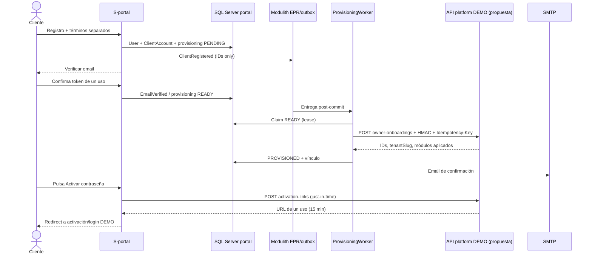
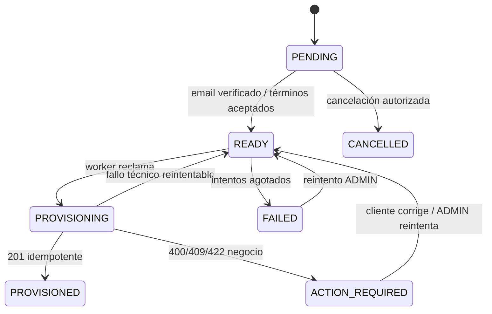

# 05 — Integración SimbioSphere

## Alcance y decisión
SimbioSphere es el SaaS multitenant existente del proyecto DEMO. D01–D04 se consideran cerradas: S-portal es nuevo e independiente; la fase MVP propone una API REST M2M nueva en DEMO como adaptador fino sobre `OwnerOnboardingOrchestratorApi`, con logins separados. Prohibido leer/escribir la BD de DEMO, hacer scraping de `/onboarding` o copiar su CSRF. La integración es una saga con llamadas fuera de transacción; este documento especifica el contrato futuro y no modifica DEMO.

## URLs por entorno confirmadas
| Entorno | Base URL | Estado |
|---|---|---|
| Local | `http://localhost:8081/` | Confirmada por el owner |
| PRE | `https://orders.simbio.info` | Confirmada por el owner; HTTPS asumido para PRE |
| Producción | Pendiente | No reutilizar PRE ni habilitar allowlist de producción hasta confirmación |

Las URLs se inyectan por configuración del entorno y nunca se comparten entre perfiles; la URL pública del propio portal sigue pendiente y se configura mediante `PORTAL_BASE_URL`.

## Evidencia verificada de DEMO
Las rutas de esta tabla son relativas a `DEMO-orders-thymeleaf`, salvo H36 (repo de identidad visual). No se incluyen valores de secretos.

| ID | Hecho verificado | Evidencia |
|---|---|---|
| H01 | Boot 3.3.5, Java 21, Layout Dialect 3.3.0, Tailwind 3.4.17, Flyway, MSSQL y Redis/Spring Session | `pom.xml:11,22,24,80-85,115,127,211`; `package.json:11`; `README.md:113-117` |
| H02 | HTMX/Alpine desde CDN; scripts inline sin nonce | `src/main/resources/templates/layouts/main.html:32-38,41,44,47,50` |
| H03 | Sin Spring Modulith, OAuth2 ni JWT en el pom | `pom.xml` (búsqueda sin coincidencias) |
| H04 | No hay API REST de alta; APIs existentes de pedidos/inventario/reparación no crean cuentas | `src/main/java/com/misnegocios/orders/api/web/OrderApiController.java:48`; `api/web/InventoryApiController.java:39`; `api/repair/RepairApiController.java:26`; `api/web/ApiKeyDebugController.java:25-26`; `branding/web/BrandingCssController.java:33,39`; `repair/catalog/web/RepairCatalogApiController.java:28`; `rgpd/web/DataExportController.java:25`; `payment/web/StripeWebhookController.java:20,34` |
| H05 | `/api/v1/**` usa `X-API-Key` limitada a tenant+sede; esa cadena excluye CSRF | `config/SecurityConfig.java:116`; `api/security/ApiKeyAuthenticationFilter.java:48-49,107,122-125,139` |
| H06 | `api-spec.yaml` no documenta `/api/v1`; README reconoce desfase | `docs/integraciones/api-spec.yaml` (0 coincidencias de `/api/v1`); `README.md:96,141` |
| H07 | Errores actuales usan `ErrorResponse` propio; existe conflicto 409 de idempotencia | `api/web/ApiErrorHandler.java:31,49,132-139` |
| H08 | `GET/POST /onboarding` es MVC+CSRF, redirige a login y no devuelve IDs | `iam/web/OwnerOnboardingController.java:29,36,46,63-68,74-84`; `config/SecurityConfig.java:139,178` |
| H09 | `/t/{tenantSlug}/auth/register` crea cliente final del tenant, no empresario | `iam/web/RegisterController.java:21,35,53` |
| H10 | `/platform/admin/**` exige sesión `ROLE_PLATFORM_ADMIN` | `platform/web/PlatformAdminController.java:58-59,89,201`; `config/SecurityConfig.java:200` |
| H11 | API interna reutilizable `OwnerOnboardingOrchestratorApi#onboard` retorna seis IDs `Long` | `shared/api/OwnerOnboardingOrchestratorApi.java:3,5`; `shared/api/OwnerOnboardingResult.java:4-9` |
| H12 | Comando interno incluye email/password, nombres, cuenta, negocio, slug/tipo, módulos y sede | `shared/api/OwnerOnboardingCommand.java:6-16` |
| H13 | Validaciones actuales de email/password/nombres, slugs y cuatro tipos de negocio | `iam/web/dto/OwnerOnboardingRequest.java:14,18,22,26,30,34,38,42,45,48,52,55-56` |
| H14 | `acceptTerms` se valida pero el controlador no lo persiste | `iam/web/OwnerOnboardingController.java:63-66` |
| H15 | Módulos seleccionables/fijos y reglas de dependencias por tipo | `shared/api/BusinessModule.java:9-23,25-30,48-55,63-66,82-87` |
| H16 | `modules` vacío y `null` se convierten en cero módulos opcionales | `iam/application/BusinessModuleSelectionValidator.java:20`; `iam/application/CustomerAccountCapabilityService.java:64,69-70` |
| H17 | `defaultSelection()` existe, no tiene llamadores y no define defaults por tipo | `shared/api/BusinessModule.java:78-79` (búsqueda de usos sin resultados) |
| H18 | Alta interna transaccional crea User no verificado, CustomerAccount/OWNER, suscripción, Tenant, membership y sede | `iam/application/OwnerOnboardingService.java:80-82,87,93,105`; `platform/application/PlatformOwnerOnboardingService.java:27,36,50,51-56` |
| H19 | Tenant owner se deriva de membership OWNER; una CustomerAccount puede agrupar varios tenants | `iam/application/OwnerOnboardingService.java:50-61`; `tenant/domain/Tenant.java:62` |
| H20 | User global; email cifrado + hash único, BCrypt(12), tokens de verificación/reset en claro y sin `externalId` | `iam/domain/User.java:52,55,58,85,88`; `shared/util/EmailHasher.java:25-26`; `config/SecurityConfig.java:534` |
| H21 | PII cifrada con AES-256-GCM y clave `AES_MASTER_KEY` | `crypto/EncryptedStringConverter.java:9,42-44`; `crypto/AesGcmCipherService.java:28` |
| H22 | Form login/sesión; email verification requerida por defecto, con excepción en perfil dev | `config/SecurityConfig.java:221-222`; `iam/application/AppUserDetailsService.java:38-39,65-66`; `src/main/resources/application.yml:91`; `application-dev.yml:40` |
| H23 | Login `/login`, `/t/{tenantSlug}/auth/login`; rutas globales de reset/verificación | `config/SecurityConfig.java:177-179,222`; `iam/web/GlobalPasswordResetController.java:23-47`; `shared/util/UrlBuilder.java:19,30` |
| H24 | Reintento interno localiza propietario solo por email, sin clave ni prueba de contraseña | `platform/application/PlatformOwnerOnboardingService.java:38-41,67-84`; `iam/application/OwnerOnboardingService.java:50-61` |
| H25 | Idempotency actual requiere tenant+sede y `location_id`; no sirve antes de crear Tenant | `idempotency/domain/IdempotencyReplay.java:21-22,29,31,40,50`; `idempotency/api/IdempotencyReplayApi.java:9-14` |
| H26 | Webhook-service usa HMAC-SHA256, key ID/timestamp/firma, ventana temporal y comparación constante | `webhook-service/src/main/java/com/misnegocios/orders/webhookservice/security/WebhookHmacAuthenticationFilter.java:33-35,76-79,133-137,152-158` |
| H27 | Webhooks salientes son de pedidos/stock; no hay lifecycle de cuenta/tenant | `webhook/web/WebhookAdminController.java:51-56` |
| H28 | Rate limits existentes para onboarding/login/register y proxies confiables | `iam/web/RateLimitFilter.java:77-88,119-122,143-159` |
| H29 | CSP actual permite unsafe-inline/eval/CDN; cookies CSRF/session tienen nombres genéricos | `config/SecurityConfig.java:56-71,113,122,133,256` |
| H30 | Navbar Alpine usa breakpoint fijo `lg`; sin ResizeObserver/focus trap | `templates/fragments/navbar.html:10-12,95-98,151,374-380,43,55` |
| H31 | Tema oscuro usa class/localStorage, por defecto claro; un layout principal | `tailwind.config.js:6`; `layouts/main.html:12,32-38,153,261`; `templates/layouts/` solo `main.html` |
| H32 | i18n usa cookie `app-locale`, `es_ES`, `?lang=`, bundles y `app.name=Orders` | `config/I18nConfig.java:29,39-42,49`; `src/main/resources/i18n/messages.properties:2` |
| H33 | Dos árboles de migraciones; literales sensibles en configuración/compose y destinatarios en log | `src/main/resources/db/…`; `application-dev.yml:24,26-27`; `notification/domain/NotificationLog.java:36-37`; `docker-compose.dev.yml:9` |
| H34 | Gobernanza M01–M12, constitución R01–R20 y ModuleArchitectureTest 8 tests/17 raíces | `docs/modules/NORMAS-DESARROLLO-MODULAR.md:23-71`; `docs/arquitectura/constitution.md:7-157`; `src/test/java/com/misnegocios/orders/architecture/ModuleArchitectureTest.java:30-37` |
| H35 | Plan `DEMO` gratuito; no anunciar precio por módulo/sede ni contratación de pago | `README.md:1,11-14,58-66`; app `README.md:187`; puertos SQL/Mailpit `docker-compose.dev.yml:12,28-29` |
| H36 | Paleta, tipografías y logos disponibles en la fuente; vídeo no existe. S-portal no reutiliza los archivos de fuentes y usa `system-ui`. | `Symbio\symbio-frontend\src\app\globals.css:6-107,110-118,125-135`; `tailwind.config.ts:13-25`; directorios de fonts/logo/hero |

## Evidencia adicional: inventario de errores en DEMO
Esta evidencia se incorpora por la ampliación solicitada. El diseño de S-portal adapta el servicio central, pero no copia a ciegas sus límites de almacenamiento o cualquier campo potencialmente sensible.

| ID | Hecho verificado | Evidencia |
|---|---|---|
| H37 | `ErrorInventoryService` es el servicio central; carga/guarda `logs-error/error-inventory.json`, registra excepciones/HTTP status, consulta, resuelve/elimina y autosalva cada cinco minutos | `shared/errortracking/ErrorInventoryService.java:41,44,66,109-124,171-178,185-232,310` |
| H38 | Fallos de persistencia se interceptan en `DatabaseErrorTrackingAspect`; `DatabaseErrorDetails` clasifica SQLState/vendor code y forma resumen/contexto saneado | `shared/errortracking/DatabaseErrorTrackingAspect.java:42,50-58,67-81`; `shared/errortracking/DatabaseErrorDetails.java:28-31,43-55,157-178` |
| H39 | Handlers MVC/API/filtro llaman al servicio central; `CustomErrorController` atiende `/error` y delega `trackError`/`trackHttpStatus`, no es el dueño del inventario | `shared/exception/CustomErrorController.java:34-42,79-94`; `shared/exception/GlobalExceptionHandler.java:62,337-370`; `shared/exception/ViewExceptionHandler.java:28,95-132`; `api/web/ApiErrorHandler.java:36,208-213`; `shared/logging/HttpErrorTrackingFilter.java:24,49,71` |
| H40 | El dashboard de plataforma consulta estadísticas/errores del servicio y muestra un visor | `platform/application/PlatformDashboardMonitoringService.java:22,29-47`; `src/main/resources/templates/platform/dashboard.html:232-270` |
| H41 | `ErrorRecord` limita stack trace a 50 frames, pero el mensaje no SQL usa `Throwable.getMessage()` sin saneamiento común explícito | `shared/errortracking/ErrorRecord.java:100-114,126-134`; tratar como riesgo de PII, no afirmar que el JSON siempre está libre de PII |
| H42 | `ErrorInventory` deduplica por mapa/huella, pero el modelo no muestra límite de tamaño/caducidad automática | `shared/errortracking/ErrorInventory.java:113-130`; definir cap/retención en S-portal |
| H43 | **VERIFICAR:** en la inspección de `src/main/resources` no se localizó listener de errores JS ni POST del navegador al inventario; la integración frontend de S-portal es nueva | Cierra ERR-003; no se presenta como capacidad existente |

Conclusiones: el contrato nuevo debe adaptarse al servicio interno (H11/H18), no exponer H24, crear idempotencia pre-tenant (H25), definir `modules` omitido/null frente a `[]` (H16/H17) y no heredar patrones inseguros de H20/H29/H33. Las únicas afirmaciones de estado actual de DEMO son las filas con evidencia; el resto de esta sección se marca como propuesta.

## Contrato OpenAPI vigente — aceptado para desarrollo local

La fuente estructurada aceptada para desarrollo local es [simbiosphere-platform-v1.yaml](contracts/simbiosphere-platform-v1.yaml). Define alta del owner, consulta de disponibilidad del slug y creación just-in-time del enlace de activación, con HMAC, scopes, idempotencia, respuestas RFC 7807 y sin contraseña. La prueba `SimbioSphereOpenApiContractTest` valida su estructura y fixtures WireMock locales; no valida un servidor WireMock ni una API DEMO.

Reconciliación de estado: el texto descriptivo original dentro del YAML se conserva para mantener la copia byte-identical compartida, pero su mención «no acordada» es histórica. La decisión normativa vigente es la autorización posterior del owner. El contrato queda **aceptado para desarrollo local v1** por autorización explícita del owner común de S-portal y DEMO el 2026-11-20, con permiso para modificar DEMO-orders-thymeleaf y ejecutar la implementación. La preparación técnica local de DEMO-01 se completó el 2026-11-20: DEMO contiene ADR-013 y una copia byte a byte idéntica del OpenAPI (SHA-256 `405887EBB18B90655B71A4BDE20D88A1C4A44FBEA96975D76DD1D6A9D7410B2F`). Los tests estructurales pasan en ambos repositorios y DEMO conserva su gate de arquitectura 8/8. La autorización permite implementar cliente, proveedor, seguridad, idempotencia y tests offline. No autoriza llamadas externas, despliegue, PRE/producción ni acredita una integración operativa real. En Portal, SIM-003 ya añade cliente tipado Java 21, HMAC/canonicalización, idempotencia, timeouts, circuit breaker y Problem Details saneados; su gate focal de `simbiosphere` pasa localmente; no reemplaza una provider test, DEMO desplegado ni E2E-004.

### Borrador inicial sustituido (histórico, no contractual)

El fragmento siguiente se conserva como antecedente. No debe usarse como fuente contractual; prevalece el YAML enlazado arriba.

Contrato futuro bajo `/api/platform/v1/**`. M2M con HMAC-SHA256: `X-Platform-Key-Id`, `X-Platform-Timestamp`, `X-Platform-Signature`; canonical propuesto `timestamp\nMETHOD\npath\nquery\nsha256(body)\nIdempotency-Key`; ventana ±300 s, dos keys activas durante rotación, scopes `provisioning:write/read`, rate limit por key ID. Secreto en gestor externo; allowlist IP opcional. **No se reutiliza `X-API-Key` tenant** (H05).

```yaml
openapi: 3.1.0
info:
  title: SimbioSphere Platform Provisioning API
  version: 1.0.0
servers:
  - url: https://{host}/api/platform/v1
paths:
  /owner-onboardings:
    post:
      operationId: createOwnerOnboarding
      security: [{ PlatformHmac: [] }]
      parameters:
        - in: header
          name: Idempotency-Key
          required: true
          schema: { type: string, minLength: 16, maxLength: 128 }
      requestBody:
        required: true
        content:
          application/json:
            schema:
              $ref: '#/components/schemas/OwnerOnboardingRequest'
      responses:
        '201': { description: Provisioned or accepted; response includes IDs and tenantSlug }
        '400': { description: Invalid request }
        '401': { description: Invalid M2M signature }
        '403': { description: Missing scope }
        '409': { description: EMAIL_ALREADY_REGISTERED, SLUG_TAKEN or IDEMPOTENCY_KEY_REUSED }
        '422': { description: INVALID_MODULES }
        '429': { description: Rate limit exceeded }
        '503': { description: Dependency unavailable }
  /tenant-slugs/{slug}/availability:
    get:
      operationId: checkTenantSlug
      security: [{ PlatformHmac: [] }]
      parameters:
        - { in: path, name: slug, required: true, schema: { type: string, pattern: '^[a-z0-9-]{3,50}$' } }
      responses:
        '200': { description: Availability and safe suggestions }
        '400': { description: Invalid slug }
  /owner-onboardings/{customerAccountId}/activation-links:
    post:
      operationId: createActivationLink
      security: [{ PlatformHmac: [] }]
      parameters:
        - { in: path, name: customerAccountId, required: true, schema: { type: integer, format: int64 } }
      responses:
        '200': { description: One-use activation URL, 15-minute TTL }
        '404': { description: Not found }
components:
  securitySchemes:
    PlatformHmac:
      type: apiKey
      in: header
      name: X-Platform-Signature
  schemas:
    OwnerOnboardingRequest:
      type: object
      required: [email, firstName, lastName, businessName, businessSlug, businessType, terms, externalReference]
      properties:
        email: { type: string, format: email }
        firstName: { type: string, maxLength: 100 }
        lastName: { type: string, maxLength: 100 }
        locale: { type: string, enum: [es, en] }
        emailVerified: { type: boolean, const: true }
        verificationEvidence: { type: string }
        accountName: { type: string, maxLength: 200 }
        businessName: { type: string, maxLength: 200 }
        businessSlug: { type: string, pattern: '^[a-z0-9-]{3,50}$' }
        businessType: { type: string, enum: [RESTAURANT, RETAIL, SERVICES, REPAIR_SHOP] }
        modules: { type: array, items: { type: string }, description: 'Omit/null requests defaults after DEMO-08; [] means none optional.' }
        locationName: { type: string, maxLength: 200 }
        locationSlug: { type: string, pattern: '^[a-z0-9-]{2,50}$' }
        terms:
          type: object
          required: [version, acceptedAt]
          properties:
            version: { type: string }
            acceptedAt: { type: string, format: date-time }
        externalReference:
          type: object
          required: [source, externalAccountId]
          properties:
            source: { type: string, const: S_PORTAL }
            externalAccountId: { type: string }
```

La muestra es un contrato de trabajo, no una API desplegada. El password se omite deliberadamente; DEMO genera al propietario y solo define contraseña mediante el enlace de activación futuro (ADR-002, opción A). `modules` omitido/null y `[]` tienen semánticas distintas tras DEMO-08.

## Avance local del Portal

PROMPT 15 creó únicamente la base de saga local: `simbiosphere.provisioning` empieza en `PENDING`, mantiene idempotencia estable, intentos/lease/reintento y referencia UUID a `ClientAccount`. `account_link` admite un vínculo externo único por `(external_system, external_account_id)` y `linked_business` admite 1..N negocios por cuenta sin asumir un owner de tenant externo. No hay llamada HTTP ni transición basada en DEMO; esas tareas siguen tras SIM-002 aprobado.

SIM-011 aporta un fallback opcional con `PORTAL_SIMBIOSPHERE_FALLBACK_ENABLED=false` por defecto. La URL debe ser HTTPS, estar en la allowlist de host y no contener credenciales, query ni fragmento; el enlace público no traslada datos del formulario. La URL `/continuar/simbiosphere` solo redirige cuando el flag está habilitado y responde 404 en otro caso.

SIM-005 está parcialmente preparado: `EmailVerified` transita solo una intención PENDING existente a READY y publica IDs tras commit. Es no-op para identidades sin cuenta/intención; no se crea intención automática desde cualquier `ClientRegistered` hasta que SIM-009 aporte el consentimiento y campos del alta conjunta.

SIM-012 queda como diseño R2: `AccountLinkPort` exige un desafío temporal de posesión, máximo de intentos y confirmación por prueba; no existe implementación ni enlace automático por email.

## Secuencia — alta conjunta y activación


La llamada remota ocurre fuera de la transacción portal. El worker reclama filas con `UPDLOCK, READPAST`, `locked_until` y reintentos; la escritura del resultado es una transacción local corta. EPR no lleva PII ni token.

## Estados y fallos


Reintento técnico con backoff+jitter propuesto: 30 s, 2 m, 10 m, 30 m, 2 h y 6 h; al agotar, `FAILED`, alerta `ADMIN` y acción manual auditada. Conflictos de negocio producen `ACTION_REQUIRED`, sin revelar si una cuenta ajena existe. La política de cancelación/compensación es local: nunca borrar tenant remoto de forma implícita.

## Vínculo de cuentas existentes (R2)
Cardinalidad: `ClientAccount` 1 ↔ 0..1 `CustomerAccount`; una cuenta DEMO puede tener varios tenants (H19). Guardar referencia externa en ambos lados con owner definido. **Prohibido vincular por email** (H24); requiere prueba de posesión, por OTP enviado por DEMO o login DEMO. `DEMO-09` agrega consulta de lifecycle/webhooks firmados y estado; queda fuera del MVP. Ver [ADR-002](../adr/ADR-002-identidad-password-simbiosphere-y-m2m.md).

## Semántica de módulos
Estado actual (H16/H17): selección vacía o `null` termina en cero módulos opcionales, y `defaultSelection()` no se invoca. Por tanto, el portal no envía `[]` como señal de defaults. Contrato futuro de DEMO-08: campo omitido/null = defaults filtrados por tipo y dependencias; `[]` = cero opcionales. El portal muestra `modulesApplied` que devuelve DEMO y no replica reglas. Evidencia: `BusinessModuleSelectionValidator.java:20`; `CustomerAccountCapabilityService.java:64,69-70`; `BusinessModule.java:78-79`.

## Alternativa temporal
Si API DEMO no está lista, `SIM-011` ofrece enlace externo a `/onboarding` por feature flag, sin enviar datos/credenciales, sin scraping ni vínculo automático. `/onboarding` es MVC+CSRF, redirige a login y no devuelve IDs (H08); el usuario debe completar alta separada. Mostrarlo como deuda técnica y no presentar el negocio como vinculado.

## Backlog DEMO
| ID | Fase | Entrega planificada | Detalle |
|---|---|---|---|
| DEMO-01 | F1 | ADR API partner | [tareas/DEMO-backlog.md](tareas/DEMO-backlog.md) |
| DEMO-02a/02b | F2 | HMAC filter, clientes/scopes | ídem |
| DEMO-03a/03b/03c | F2–F3 | Idempotencia platform, POST alta, errores | ídem |
| DEMO-04 | F3 | Availability de slug | ídem |
| DEMO-05 | F2 | Referencia externa y migraciones | ídem |
| DEMO-06a/06b | F4 | Alta sin password y activation link | ídem |
| DEMO-07/08 | F4 | Términos y defaults por tipo | ídem |
| DEMO-10/11 | F5 | Owners/gates y pruebas provider | ídem |
| DEMO-09/12 | R2 | Vínculo existente/lifecycle y catálogo | épicas sin desglosar |

Todos los cambios de DEMO requieren su propia revisión/ejecución en el repositorio DEMO; este plan no ejecuta ninguno.
