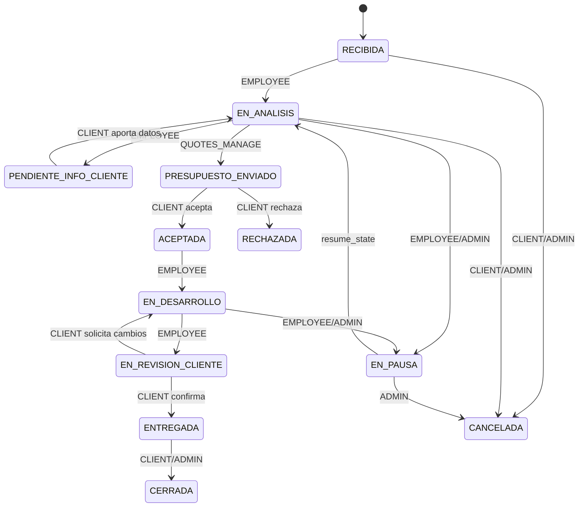
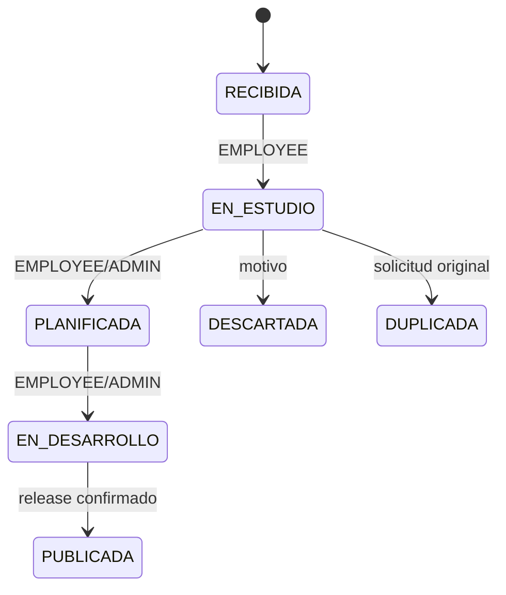

# 07 — Seguridad y RGPD

## Límites de confianza
- Navegador público → MVC/CSRF → módulos web → application/domain → SQL Server; ficheros entran en cuarentena y salen solo tras escaneo/autorización.
- Portal → API M2M DEMO por TLS/HMAC; nunca navegador→DEMO con secreto, acceso DB cruzado ni flujo de scraping.
- Outbox/EPR es frontera asíncrona: eventos transportan IDs y estado mínimo, nunca password, token o PII.
- Proxy TLS y gestor de secretos son componentes externos (**VERIFICAR** plataforma/proveedores antes de producción).

## STRIDE de flujos críticos
| Flujo | S/T/R/I/D/E: amenaza | Controles y evidencia |
|---|---|---|
| Alta conjunta portal→DEMO | Spoofing de partner; tampering de payload; repudiación; divulgación de password; DoS/replay; elevación de scope | HMAC-SHA256, timestamp ±300 s, `Idempotency-Key`, dos claves activas, scopes separados, TLS, rate limit/circuit breaker, eventos con IDs. Tests `SIM-003/004/013`, `DEMO-02a/b`, `DEMO-03a/b/c`. |
| Registro/login/invitación | Enumeración, credential stuffing, session fixation, token replay, elevación a ADMIN | Mensaje genérico, cuotas IP/email, Argon2id, token hashado/one-use/TTL, `SPORTAL_SESSION`, rotación al login, MFA TOTP ADMIN, bootstrap externo de un uso. Tests IAM/CUS/E2E. |
| Solicitud/presupuesto | Spoofing de actor, manipulación public ID, IDOR, repudiación de presupuesto, acceso interno | Rol **y** propietario en query/command, estados permitidos, append-only evidence y auditoría; CLIENT solo su cuenta, PUBLIC en hilo. `REQ-011`, `TC-QUO-003`, `TC-EMP-006`. |
| Contacto, adjuntos y audio | Spam, malware, MIME spoofing, SSRF, XSS, abuso de micrófono, exfiltración | Honeypot/prueba de trabajo local y cuotas, URLs no descargadas, Tika+allowlist+límites, ClamAV fail-closed/cuarentena, micrófono tras acción con `Permissions-Policy`, CSP. La prueba de trabajo aún no demuestra compatibilidad con ALTCHA oficial ni replay guard multi-réplica. `IAM-006`, `FIL-002/003`, `MSG-003/005`. |
| CMS y medios | Stored XSS, enlaces/script activo, edición no autorizada, publicación falsa | `CONTENT_EDIT`, preview noindex/no-store, sanitizer server-side allowlist, `th:utext` solo desde salida sanitizada; auditoría y snapshot. `CMS-003/005/007`. |
| Mensajería y notas | Fuga INTERNAL por query/fragment/email, enlace mágico transferible, spam de respuesta | PUBLIC/INTERNAL filtrado en API/SQL, `INBOX_MANAGE`, token ≥128 bits hashado, limitado al hilo, expiración/revocación, rate limit. `MSG-002/010`, `REQ-011`. |
| Inventario de errores | Spoofing del origen frontend; contenido/stack con PII; enumeración del archivo; flood DoS; acceso no autorizado a incidentes | Opt-in explícito previo, denegado por defecto; banda no modal con aceptar/rechazar y revocación, decisión versionada en localStorage sin identidad ni registro backend; fallo al guardar mantiene denegado. Intake same-origin + CSRF activo + `Origin` exacto + JSON no comprimido ≤4 KiB; rate limit en memoria (30 de ráfaga y 30/minuto; cliente cinco/minuto); DTO con evento/nombre allowlisted, release fijado en servidor, locale, correlación, ruta reducida y solo marcos de JS local fingerprinted. No se envían mensajes libres, DOM, formularios, cookies, headers ni query strings; payloads inválidos del endpoint no se vuelven a registrar como BACKEND. JSON fuera del webroot con ACL; visor/resolución ADMIN-only; fallo del tracker no reemplaza excepción original. Copy de consentimiento provisional, requiere revisión legal antes de producción. Ninguna reparación IA ni ejecución automática en MVP. `ERR-001..004`. |
| Operación/secretos | Secretos expuestos, dependencia vulnerable, backup robado, PII en logs/metrics | Secret manager/entorno, rotación, Dependency-Check/Trivy, cifrado backups, correlation ID, masking, métricas agregadas y Actuator protegido. `FND-007/008/010`, HRD. |

## Matriz de autorización rol × acción
**Roles:** `CLIENT`, `EMPLOYEE`, `ADMIN` (ADMIN también trabajador), principal M2M `S_PORTAL`; rol se combina con propietario/permiso específico. «Asignado» significa permiso explícito, no acceso por ocultar enlaces.

| Acción/recurso | Anónimo | CLIENT | EMPLOYEE | ADMIN | M2M `S_PORTAL` |
|---|---|---|---|---|---|
| Leer páginas CMS publicadas | Sí | Sí | Sí | Sí | No |
| Enviar contacto público | Sí, con anti-abuso | Sí, ligado a cuenta | No por UI cliente; bandeja según permiso | Sí | No |
| Registro autoservicio | Crear CLIENT | No | No | Crear por invitación | No |
| Ver/editar perfil | No | Solo propio | Solo propio | Gestionar por `USERS_MANAGE`, auditado | No |
| Ver solicitudes | No | Solo propias | Todas con `REQUESTS_VIEW_ALL` | Todas | No |
| Crear/cancelar/aportar información | No (login requerido; conserva borrador) | Solo propias y estados permitidos | No como cliente | No como cliente; operación administrativa separada | No |
| Cambiar estado/asignar | No | No | `REQUESTS_VIEW_ALL` + `REQUESTS_ASSIGN` | Sí | No |
| Emitir presupuesto | No | No | `QUOTES_MANAGE` | Sí | No |
| Aceptar/rechazar presupuesto | No | Solo propio, vigente y autenticado | No | No como cliente | No |
| Leer/crear nota INTERNAL | No | Nunca | `INBOX_MANAGE`/permiso de solicitud | Sí | No |
| Bandeja: leer/responder/archivar | No | Solo respuesta pública en hilo propio | `INBOX_MANAGE` | Sí | No |
| Purga definitiva bandeja | No | No | No | `INBOX_PURGE` | No |
| Editar CMS/publicar | No | No | Solo con `CONTENT_EDIT` asignado | Sí | No |
| Consultar auditoría | No | No | Solo con `AUDIT_VIEW` asignado | Sí | No |
| Consultar/resolver inventario de errores | No | No | No | `ERROR_INVENTORY_MANAGE` y rol `ADMIN` | No |
| Gestionar trabajadores/clientes/CSV | No | No | No por defecto | `STAFF_MANAGE`, `USERS_MANAGE`, `CLIENTS_EXPORT` | No |
| Ver estado SimbioSphere | No | Solo cuentas vinculadas propias | No | `PROVISIONING_MANAGE` | `provisioning:read` |
| Crear/reintentar provisioning | No | Solicitar alta propia; reintento automático | No | `PROVISIONING_MANAGE` para reintento manual | `provisioning:write` |

Matriz final de endpoint/ruta/permiso se mantiene con IAM-012. Las acciones exportables se limitan, registran y neutralizan fórmulas CSV.

## Contrato por familias de rutas
Regla global: toda página HTML conserva tema claro/oscuro con tokens y layout responsive, y resuelve ES/EN según URL pública o preferencia privada. Todo `POST`/mutación HTMX usa CSRF; GET/HEAD de solo lectura no muta. Cada fragmento aplica autorización en su handler, no solo en la página contenedora.

| Ruta/página o endpoint | Quién puede acceder | CSRF/controles de mutación | Locale/tema y viewport |
|---|---|---|---|
| `/{lang}/`, `/{lang}/simbiosphere`, `/servicios/**`, `/sobre-nosotros`, `/legal/**`, slugs CMS | Anónimo; usuario autenticado también puede leer | GET no muta; formularios POST que partan de página pública requieren token | `/{lang}` ES/EN, tokens y layout público responsive |
| `/{lang}/contacto` | Anónimo/usuario; POST crea CONTACT | CSRF + consent + ALTCHA/honeypot + rate limit; nunca descarga URL | Locale de URL; tema; formulario/audio móvil, teclado y errores asociados |
| `/acceso`, `/registro`, `/verificar-email`, `/recuperar`, `/restablecer`, `/invitacion/aceptar` | Anónimo con token de un uso donde aplique | POST CSRF, cuotas, token hashado/TTL; respuestas anti-enumeración | Locale ES/EN; tema; formulario mobile-first |
| `/cuenta/perfil`, `/cuenta/notificaciones`, `/cuenta/datos` | Sesión del titular; recurso propio | POST CSRF + reautenticación para baja/cambios sensibles | Perfil→cookie→Accept-Language; tema; responsive |
| `/cuenta/solicitudes/**`, `/cuenta/simbiosphere/**` | CLIENT verificado y owner de ClientAccount/solicitud | POST/HTMX CSRF; revisar owner en query y comando; enlaces DEMO allowlisted | Preferencia privada; tema; tablas/detalles y acciones usables en móvil |
| `/gestion/**` (clientes, trabajadores, CMS, auditoría, solicitudes, bandeja, provisioning) | EMPLOYEE/ADMIN con permiso por acción | Cada POST/fragmento CSRF; permisos específicos (`CONTENT_EDIT`, `AUDIT_VIEW`, etc.); auditoría | Locale privado; tema; tablas paginadas y filtros responsive |
| `/gestion/errores` y endpoints de consulta/resolución | Rol `ADMIN` con `ERROR_INVENTORY_MANAGE`; denegar CLIENT/EMPLOYEE | CSRF al resolver/ignorar; cap de consulta y texto; acciones auditadas | Locale privado, claro/oscuro, tabla accesible; sin acceso al path JSON |
| `/api/telemetry/errors` (ingesta frontend) | Navegador same-origin con consentimiento explícito; sin sesión privilegiada | No se envía por defecto ni tras rechazo/revocación; si localStorage no guarda el opt-in, captura denegada. En endpoint: CSRF, `Origin` exacto, JSON no comprimido, body ≤4 KiB y rate limit por proceso; source/release se fijan en servidor | Endpoint no UI; acepta evento/nombre allowlisted, locale/correlation, ruta reducida y marcos de JS local fingerprinted; no acepta mensajes libres ni guarda query o datos de formulario |
| `/sitemap.xml`, `/robots.txt` | Público de solo lectura | Sin mutación; incluir solo URLs publicadas | URLs ES/EN, canonical/hreflang; respuesta no UI |
| `/actuator/**` en management port 8091 | Probe/plataforma interna, no visitante ni usuario normal | Red interna + política de autenticación; nunca exponer `/env` | No tiene locale/tema/UI; solo health/readiness/métricas autorizadas |
| Llamada saliente portal→DEMO `/api/platform/v1/**` | Servicio `simbiosphere` con secret/key autorizada | No es endpoint web del portal; HMAC, scopes, replay guard, TLS e idempotencia; CSRF no aplica al cliente saliente | No UI/locale; estado para cliente se presenta en `/cuenta/simbiosphere` |

## Máquinas de estado y transiciones
Las siguientes tablas completan las propuestas del prompt. Códigos persistidos son estables; etiquetas de cliente se traducen. Todos los cambios llevan actor, fecha UTC, estado origen/destino y audit event. Transiciones no listadas se rechazan con 409/422. Las reglas de cancelación/cierre marcadas SUPUESTO deben confirmarse en refinamiento de negocio.

### `CUSTOM_DEVELOPMENT`

| Origen → destino | Rol/precondición | Efecto/auditoría | Visibilidad CLIENT |
|---|---|---|---|
| RECIBIDA→EN_ANALISIS | EMPLOYEE/ADMIN con `REQUESTS_VIEW_ALL` | Asignación opcional, history + aviso al responsable | «En análisis» |
| EN_ANALISIS→PENDIENTE_INFO_CLIENTE | EMPLOYEE; pregunta/motivo obligatorio | Mensaje PUBLIC y aviso al titular | «Necesitamos información» |
| PENDIENTE_INFO_CLIENTE→EN_ANALISIS | CLIENT owner aporta información | `MessagePosted`, history, aviso a staff | «En análisis» |
| EN_ANALISIS→PRESUPUESTO_ENVIADO | EMPLOYEE con `QUOTES_MANAGE`; quote SENT vigente | Guardar versión y notificar | «Presupuesto enviado» |
| PRESUPUESTO_ENVIADO→ACEPTADA/RECHAZADA | CLIENT owner, decisión de versión vigente | Evidencia actor/versión/fecha; idempotente | «Aceptada»/«Rechazada» |
| ACEPTADA→EN_DESARROLLO | EMPLOYEE; presupuesto aceptado | Registrar inicio/actor | «En desarrollo» |
| EN_DESARROLLO→EN_REVISION_CLIENTE | EMPLOYEE; entrega candidata adjunta o mensaje público | Notificar y exponer solo contenido PUBLIC | «En revisión» |
| EN_REVISION_CLIENTE→EN_DESARROLLO | CLIENT owner solicita cambios | Mensaje público ligado a nueva iteración | «En desarrollo» |
| EN_REVISION_CLIENTE→ENTREGADA | CLIENT confirma aceptación (**SUPUESTO**) | Evidencia de confirmación | «Entregada» |
| ENTREGADA→CERRADA | CLIENT confirma; ADMIN puede cerrar con motivo (**SUPUESTO**) | Cierre auditado, conserva historial | «Cerrada» |
| Estados activos→EN_PAUSA / EN_PAUSA→resume_state | EMPLOYEE/ADMIN con motivo; guardar estado previo | Pausa/reanudación auditada | «En pausa»/etiqueta del estado reanudado |
| RECIBIDA/EN_ANALISIS→CANCELADA | CLIENT owner; no hay trabajo iniciado (**SUPUESTO**) | Motivo y cancelación auditados | «Cancelada» |

### `SIMBIOSPHERE_MODULE`

| Origen → destino | Rol/precondición | Efecto/auditoría | Visibilidad CLIENT |
|---|---|---|---|
| RECIBIDA→EN_ESTUDIO | EMPLOYEE con `REQUESTS_VIEW_ALL` | Crear estudio, registrar owner | «En estudio» |
| EN_ESTUDIO→PLANIFICADA | EMPLOYEE/ADMIN; decisión priorizada | Guardar fecha/roadmap interno | «Planificada» |
| EN_ESTUDIO→DESCARTADA | EMPLOYEE/ADMIN; motivo obligatorio | Motivo público sanitizado y audit | «No planificada» + motivo público |
| EN_ESTUDIO→DUPLICADA | EMPLOYEE/ADMIN; original existente y accesible | Referenciar original; no copiar mensajes privados | «Duplicada» + referencia pública |
| PLANIFICADA→EN_DESARROLLO→PUBLICADA | EMPLOYEE/ADMIN; release efectivamente disponible | Historial de progreso y release | «En desarrollo»/«Publicada» |

### Presupuesto, conversación y aprovisionamiento
- Quote: `DRAFT→SENT` por EMPLOYEE con `QUOTES_MANAGE` y validez; `SENT→ACCEPTED/REJECTED` por CLIENT owner con versión/evidencia; `SENT→EXPIRED` por job UTC. Estado terminal no se sobrescribe; corrección crea versión nueva.
- Conversación: `ABIERTA↔PENDIENTE` por respuesta del lado esperado; `ABIERTA/PENDIENTE→CERRADA` por EMPLOYEE; `CERRADA→ABIERTA` al recibir nuevo mensaje autorizado; `CERRADA→ARCHIVADA` por staff, `ARCHIVADA→ABIERTA` al restaurar. Papelera/purga es operación separada; `INBOX_PURGE` solo ADMIN.
- Aprovisionamiento: `PENDING→READY→PROVISIONING→PROVISIONED`; errores negocio→`ACTION_REQUIRED`; técnico vuelve a `READY` con backoff y, agotado, `FAILED`; reintento ADMIN devuelve a `READY`; cancelación autorizada `PENDING→CANCELLED`. Secuencia/diagrama está en [05](05-integracion-simbiosphere.md).

## Controles transversales
- **Autenticación:** Argon2id mediante `DelegatingPasswordEncoder`, política 12–64; email verificado para login; respuesta anti-enumeración; MFA TOTP obligatorio ADMIN, opcional EMPLOYEE MVP; invitación sin password prefijado.
- **Autorización:** autorización denegada por defecto; rol+propiedad en cada `application` query; IDs públicos no sustituyen control de acceso; cada fragmento HTMX repite checks.
- **CSRF/sesión:** CSRF en toda mutación web, HTMX incluido; exención solo cadena M2M platform; cookie `SPORTAL_SESSION` (`HttpOnly`, `Secure`, `SameSite=Lax`) y CSRF `SPORTAL_XSRF`; nombre distinto a DEMO por host localhost compartido.
- **Cabeceras/CSP:** nonce por request, sin `unsafe-inline/eval`, `frame-ancestors`, HSTS, nosniff, Referrer/Permissions-Policy; Alpine CSP local y `htmx.config.allowEval=false`. HRD-002 cambia report-only a enforce.
- **Tokens/PII:** tokens aleatorios ≥128 bits, guardados hashados; cifrado columna AES-256-GCM con versión para tax ID, teléfono, TOTP, IP si necesaria y outbox; email/nombres/texto para búsqueda protegidos por cifrado de disco/TDE/backups según edición (**VERIFICAR** ADR-009/006). No registrar bodies, destinatarios, activation URL ni secrets.
- **Subida:** magic bytes/Tika, allowlist, tamaño/píxeles acotados, sin SVG activo; nombre aleatorio fuera webroot, ClamAV + cuarentena, descarga autorizada `attachment` y `nosniff`.
- **Error intake:** validar estructura/tamaño antes de parsear; permitir solo clases de campos conocidas; descartar query string, body, cookies, tokens, SQL raw y stack frontend sin scrub; rate limit por IP con IP no persistida en el record. Clasificar también errores esperados/4xx útiles en vez de descartarlos sin rastro. El inventario no vive en SQL Server y el fallo del writer no lanza un segundo error que oculte el primero.
- **Abuso:** Bucket4j por IP/email en login/registro/reset/contacto; ALTCHA+honey pot por defecto; proxy trusted list explícita. Logs con correlation ID sin PII.
- **Integración M2M:** HMAC/timestamp/query/body hash/idempotency, scope mínimo, rotación, replay guard, timeouts, errores RFC 7807 y no enumeración. H24 no se expone.

## Mapa OWASP Top 10
| Categoría | Aplicación/controles | Gates/tareas |
|---|---|---|
| A01 Broken Access Control | matriz, owner checks, CSRF, fragmentos protegidos, PUBLIC/INTERNAL | IAM-012, REQ-011, HRD-001 |
| A02 Cryptographic Failures | Argon2id, tokens hashados, cifrado columna/TLS/backups | IAM-002/003, HRD-010 |
| A03 Injection | Thymeleaf autoescape, sanitizer CMS, SQL parametrizado, URL allowlist | CMS-003, tests SEC |
| A04 Insecure Design | threat model, saga, idempotencia, aprobación IA humana | ADR-002/011, SIM-006, HRD-001 |
| A05 Security Misconfiguration | CSP, cookies, headers, no secrets en profiles, permisos CI | FND-007/009, HRD-002/010 |
| A06 Vulnerable Components | BOM fijada, Dependency-Check/Trivy, SBOM/licencias | FND-008, HRD-013 |
| A07 Identification/Auth Failures | verificación email, MFA, bloqueo, rate limit, tokens one-use | IAM-003..010, HRD-001 |
| A08 Software/Data Integrity | EPR, snapshots, HMAC, contratos OpenAPI y gates | FND-004, SIM-004/013, GOV-005 |
| A09 Logging/Monitoring Failures | auditoría minimizada, correlation ID, alertas, métricas sin PII | AUD-001, FND-010, HRD-007 |
| A10 SSRF | URLs de referencia nunca descargadas; egress allowlist | REQ-005, HRD-001 |

## RGPD/LOPDGDD/LSSI-CE
- Aviso legal, privacidad, cookies y términos versionados por CMS; aceptación legal con versión/fecha/origen; consentimiento comercial separado y no premarcado.
- Registro de actividades (RAT), encargados de hosting/email/antivirus/captcha y transferencias; solo producción tras validación responsable legal/DPO.
- Derechos: acceso, rectificación, supresión por anonimización, oposición, portabilidad y limitación; exportación con caducidad; owners aportan `PersonalDataContributor`. El SPI existe, pero no hay todavía contributors de dominio ni servicio/tabla de solicitudes, por lo que no se ofrece exportación.
- El registro de consentimiento exige que el actor autenticado coincida con el sujeto; conserva propósito, versión de documento publicado, locale, origen y hora UTC, sin IP. El registro `/registro` vuelve a comprobar versiones legales antes de crear datos y separa el marketing opcional. El test-source Java compiló, pero los tests no se ejecutaron porque Surefire no pudo resolver una dependencia del repositorio offline.
- El alta pública crea usuarios CLIENT no verificados y no activa acceso hasta la verificación de email. El resultado de email duplicado es genérico. El formulario toma ES/EN del locale de petición; teléfono se valida en E.164 y persiste cifrado, y el identificador fiscal es opcional, cifrado y solo sintácticamente validado para España.
- La invitación customer requiere ADMIN más `USERS_MANAGE`, CSRF y comprobación del servicio; el email/token permanecen bajo owner identity. Customer guarda una referencia opaca y nombre cifrado, y crea la cuenta OWNER tras el evento de aceptación. No hay caducidad/limpieza de metadatos customer pendientes; no activar purgas no aprobadas.
- La anonimización irreversible permanece bloqueada hasta aprobación legal. Retención queda limitada a dry-run: no hay política activa ni job de purga implementado; las cifras de la tabla son propuestas, no plazos aprobados.
- Cookies: solo técnicas por defecto; analítica sin cookies preferida. En el estado actual se usan las preferencias técnicas de tema/idioma y la sesión; no hay integración de cookies opcionales ni analítica de terceros configurada, así que no se muestra un banner de cookies. Los informes técnicos de errores son independientes, requieren aceptación explícita y usan un POST same-origin protegido con CSRF. `npm run test:privacy` valida estos límites; si se configura una cookie no esencial, deberá permanecer bloqueada hasta consentimiento explícito. No activar no esenciales antes de consentimiento ni publicar el texto legal pendiente de aprobación.
- Las cifras siguientes son **propuestas de retención**, no una afirmación de plazo legal. HRD-008 y la pregunta de 13 deben recibir aprobación antes de activar purgas.

| Categoría | Plazo/acción propuesta | Notas |
|---|---|---|
| Cuenta activa | Mientras dure relación; al pedir baja, anonimizar | Preservar obligaciones aprobadas |
| Solicitudes/mensajes | 5 años seudonimizados tras baja | Propuesta a validar por defensa/obligación |
| Contacto sin cuenta | 12 meses | Purgar hilo/contenido al vencer |
| Adjuntos de contacto | 12 meses | Cuarentena/purga independiente |
| Audio contacto | 6 meses | Reducir exposición por sensibilidad |
| Logs app | 90 días | PII/token enmascarados |
| Auditoría admin/seguridad | 3 años | Solo metadatos mínimos |
| Outbox de email | 7 días tras envío | Payload cifrado y purgado |
| Tokens expirados | 30 días | Retener hash/status solo para anti-replay, luego purgar |
| Consentimientos | Relación + 3 años propuesta | Verificar plazo y base legal |

Purgas son idempotentes, auditables sin contenido, con legal hold y dry-run; no borrar evidencia antes de aprobación.
