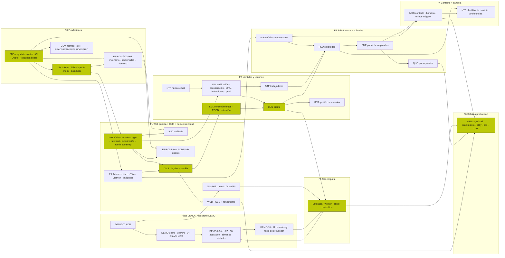

# 10 — Roadmap y backlog

Fuente de verdad de IDs, dependencias y estimaciones. El detalle de cada tarea (formato obligatorio del prompt §14) está en [tareas/](tareas/):
[F0 fundaciones](tareas/F0-fundaciones.md) · [F0 UI kit y gobernanza](tareas/F0-ui-kit-y-gobernanza.md) · [F0 inventario de errores](tareas/F0-error-inventory.md) · [F1 audit/files/identidad](tareas/F1-audit-files-identidad.md) · [F1 inventario de errores](tareas/F1-error-inventory.md) · [F1 CMS](tareas/F1-cms.md) · [F1 web/SEO/contrato](tareas/F1-web-seo-contrato.md) · [F2 notificaciones e identidad](tareas/F2-notificaciones-identidad.md) · [F2 legal y clientes](tareas/F2-legal-clientes.md) · [F2 staff y gestión de usuarios](tareas/F2-staff-gestion-usuarios.md) · [F3 modelo, estados y cliente](tareas/F3-modelo-estados-cliente.md) · [F3 presupuestos y empleados](tareas/F3-presupuestos-empleados.md) · [F4 contacto y bandeja](tareas/F4-contacto-bandeja.md) · [F5 SimbioSphere](tareas/F5-simbiosphere.md) · [F6 endurecimiento](tareas/F6-endurecimiento.md) · [Backlog DEMO](tareas/DEMO-backlog.md).

## 1. Principios de planificación

- **Una tarea = un cambio atómico ≤ 1 día** (S ≤ 0,5 d, M ≤ 1 d). Lo mayor se ha dividido. No se usa Git; esta atomicidad describe el alcance de trabajo, no un commit.
- **MVP = F0–F6.** "Fase 2" de los requisitos ([02](02-requisitos.md)) se llama aquí **R2** (post-MVP) para no confundirla con la fase de construcción F2. R2 y R3+ están en el apartado 7: se documentan, no se construyen.
- **Contrato primero:** el OpenAPI portal↔DEMO ([05](05-integracion-simbiosphere.md)) se acuerda en F1 (SIM-002) y la pista DEMO arranca en F1; el portal desarrolla contra stubs WireMock hasta que DEMO publique la API.
- **Reordenación respecto al orden sugerido (justificada):**

| Cambio | Motivo |
|---|---|
| Núcleo de `identity` (IAM-001/002/004/005/012 + bootstrap del primer ADMIN IAM-014) pasa de F2 a **F1** | El backoffice del CMS (CMS-005) y la UI de auditoría (AUD-002) exigen autenticación y permisos reales (`CONTENT_EDIT`, `AUDIT_VIEW`); no se introduce un login falso. El resto de identidad (verificación, recuperación, MFA, invitaciones, perfil) sigue en F2. |
| Núcleo de `notification` (outbox + SMTP + plantillas) pasa de F4 a **F2** (NTF-001..003) | Verificación de email, recuperación e invitaciones (F2) necesitan enviar correo. F4 conserva plantillas de dominio, preferencias y alertas. |
| Núcleos de `files` y `audit` pasan a **F1** | Biblioteca de medios del CMS (subida validada) y auditoría de publicaciones se necesitan en F1. |
| Núcleo de `messaging` (MSG-001/002) pasa de F4 a **F3** | La conversación de una solicitud (RF-EMP-03) usa el mismo módulo de mensajería (RF-MSG-07). F4 añade contacto público, bandeja y enlace mágico. |
| `SIM-002` (contrato OpenAPI) y `DEMO-01` en **F1** | Contrato primero; reduce el riesgo del camino crítico. |
| `SIM-014` (selector de negocio vinculado) en **F5** | `request → simbiosphere` solo existe cuando existe `simbiosphere`; hasta entonces el campo queda vacío. |

## 2. Fases e hitos

| Fase | Objetivo | Salida verificable (hito) | Módulos que nacen | Nº tareas |
|---|---|---|---|---:|
| **F0 Fundaciones** | Esqueleto modular con gates, CI, configuración Docker declarativa, layouts, tema, i18n, menú, inventario central de errores y documentación viva | **M0:** build con Maven 3.6.3/JDK 21, pruebas H2 y gates Modulith + ArchUnit + i18n + plantillas + contraste + redacción de errores en verde; página de ejemplo ES/EN y captura de errores probada. SQL Server queda como destino productivo sin compatibilidad verificada | `shared`, `config` | 28 |
| **F1 Web pública + CMS** | Web bilingüe gestionada con CMS, textos legales y SEO, núcleo de identidad y visor ADMIN del inventario de errores | **M1:** web pública ES/EN editable por ADMIN con legales versionados, sitemap/hreflang, Lighthouse ≥ 90 y visor de errores protegido en CI | `audit`, `files`, `content`, `identity`, `config` | 36 |
| **F2 Identidad y usuarios** | Registro, verificación, MFA admin, recuperación, invitaciones, gestión de clientes y trabajadores | **M2:** un cliente se registra y verifica; un ADMIN (con MFA) invita a un trabajador y gestiona usuarios; baja RGPD operativa | `notification`(núcleo), `legal`, `customer`, `staff` | 25 |
| **F3 Solicitudes y empleados** | Solicitudes de ambos tipos, máquinas de estado, presupuestos y portal de empleados | **M3:** recorrido cliente→solicitud→asignación→presupuesto→aceptación con IDOR y notas internas probados | `messaging`(núcleo), `request` | 25 |
| **F4 Contacto y bandeja** | Contacto público, bandeja, enlace mágico, notificaciones de dominio | **M4:** contacto (texto/adjunto/audio) → bandeja → respuesta → continuación por enlace mágico | — | 14 |
| **F5 Alta conjunta SimbioSphere** | Saga de aprovisionamiento, panel "Mi SimbioSphere" y contrato con DEMO | **M5:** registro conjunto end-to-end contra DEMO real (CI compartida) y con stubs; estados `ACTION_REQUIRED`/`FAILED` operables | `simbiosphere` | 14 |
| **F6 Endurecimiento y salida** | Seguridad, rendimiento, accesibilidad, operación, backups, release | **M6:** checklist de salida firmada, UAT, procedimiento de restauración documentado, alertas activas | — | 14 |
| **Pista DEMO** (repo DEMO, plan aparte) | API de aprovisionamiento M2M | DEMO publica `/api/platform/v1/**` con tests de proveedor y gate ArchUnit 8/8 | — | 14 |

## 3. Épicas

| Épica | Descripción | Módulo owner | Fase | Tareas |
|---|---|---|---|---:|
| FND | Esqueleto, build, CI, Docker, seguridad y observabilidad base | build/config | F0 | 10 |
| UIK | Pipeline front, tokens, tipografías, tema, i18n, layouts, menú, componentes, E2E base | config | F0 | 9 |
| GOV | Normas, instrucciones, skill, README/INVENTARIO/DIARIO, ADR versionados y tests de documentación | docs | F0 | 6 |
| ERR | Inventario central y captura de errores backend, frontend y BD; visor ADMIN | config | F0/F1 | 4 |
| AUD | Auditoría | `audit` | F1 | 2 |
| FIL | Ficheros: almacenamiento, validación, antivirus, imágenes | `files` | F1 | 4 |
| CMS | CMS bilingüe, medios, equipo, legales, semilla y copy de gratuidad/condiciones | `content` | F1 | 13 |
| WEB | Páginas públicas, hero, legales, rendimiento | `content` | F1 | 7 |
| SEO | Metadatos, JSON-LD, sitemap, robots | `content` | F1 | 2 |
| NTF | Notificaciones (núcleo F2; dominio y preferencias F4) | `notification` | F2/F4 | 5 |
| IAM | Identidad, sesión, MFA, tokens, invitaciones, perfil, autorización (núcleo en F1, resto en F2) | `identity` | F1/F2 | 14 |
| LGL | Consentimientos, derechos RGPD, retención | `legal` | F2 | 3 |
| CUS | Cuenta cliente, registro, alta por admin | `customer` | F2 | 4 |
| STF | Trabajadores | `staff` | F2 | 2 |
| USR | Gestión de usuarios en backoffice | `customer`/`staff`/`identity`/`legal` | F2 | 4 |
| MSG | Mensajería, contacto, bandeja, enlace mágico | `messaging` | F3/F4 | 13 |
| REQ | Solicitudes del cliente | `request` | F3 | 11 |
| QUO | Presupuestos | `request` | F3 | 4 |
| EMP | Portal de empleados | `request` | F3 | 7 |
| SIM | Integración SimbioSphere | `simbiosphere` | F1/F5 | 14 |
| HRD | Endurecimiento y salida | transversal | F6 | 14 |
| E2E | Recorridos críticos Playwright | test | F2–F5 | 4 |
| DEMO | Backlog en DEMO | DEMO | F1–F5 | 14 |

## 4. Catálogo de tareas (IDs, dependencias y estimación)

`Cubre` lista los requisitos de [02-requisitos.md](02-requisitos.md). `(DEMO)` = dependencia en la pista DEMO. Estimación: **S** = 0,5 d · **M** = 1 d.

### F0 — Fundaciones

| ID | Fase | Título | Módulo | Depende de | Cubre | Est. |
|---|---|---|---|---|---|---|
| FND-001 | F0 | Spike de stack y verificación de versiones (cierra ADR-001) | build | — | RF-GOV-01, RNF-DB-01 | M |
| FND-002 | F0 | Esqueleto Maven (Boot estable, Java 21), paquete base y wrapper | build | FND-001 | RNF-OPS-03 | S |
| FND-003 | F0 | Kernel `shared` y SPIs (CurrentUser, RecipientDirectory, PersonalDataContributor, NavContribution) | shared | FND-002 | RF-GOV-01 | M |
| FND-004 | F0 | Gates modulares: Modulith verify + reglas ArchUnit de capas | build | FND-003 | RF-GOV-02, RNF-TST-01 | M |
| FND-005 | F0 | docker-compose dev (SQL Server 2022, Mailpit, ClamAV) y `.env.example` | infra | FND-002 | RNF-DB-01, RNF-OPS-03 | S |
| FND-006 | F0 | Flyway + H2 para pruebas + convención de migraciones por módulo | build | FND-002, FND-005 | RNF-DB-01, RNF-DB-02, RNF-DB-03 | M |
| FND-007 | F0 | Perfiles dev/test/prod, propiedades tipadas y secretos por entorno | config | FND-002 | RNF-SEC-09, RNF-OPS-03 | S |
| FND-008 | F0 | Pipeline CI con gates (tests, cobertura por módulo, dependencias, i18n, plantillas) | infra | FND-004, FND-006 | RF-GOV-02, RNF-SEC-09, RNF-TST-06 | M |
| FND-009 | F0 | Seguridad base: cadena Security, cookies propias, CSRF, cabeceras y CSP con nonce | config | FND-002, FND-007 | RNF-SEC-02, RNF-SEC-03, RNF-SEC-04 | M |
| FND-010 | F0 | Observabilidad base: logs JSON, correlation ID, enmascarado de PII y Actuator protegido | config | FND-002 | RNF-SEC-08, RNF-OPS-01 | M |
| ERR-001 | F0 | Inventario central de errores y persistencia JSON fuera de la BD | config | FND-002, FND-003, FND-007 | RF-ERR-01 | M |
| ERR-002 | F0 | Captura backend y fallos SQL con metadatos saneados | config | ERR-001, FND-006, FND-010 | RF-ERR-01 | M |
| ERR-003 | F0 | Captura frontend de errores JavaScript por endpoint same-origin | config | ERR-001, FND-009, UIK-006 | RF-ERR-01 | M |
| UIK-002 | F0 | Tokens de tema claro/oscuro, mapeo Tailwind y test de contraste | config | FND-002 | RF-UI-02, RF-UI-03 | M |
| UIK-003 | F0 | Tipografía del sistema sin fuentes web externas | config | FND-002 | RF-UI-04 | S |
| UIK-004 | F0 | Mecanismo de tema (anti-FOUC con nonce, cookie, conmutador) | config | UIK-002, FND-009 | RF-UI-02 | M |
| UIK-005 | F0 | Infraestructura i18n (URL `/{lang}`, resolver, bundles por módulo, test de claves) | config | FND-002 | RF-UI-05, RNF-TST-05 | M |
| UIK-006 | F0 | Layouts público/cliente/backoffice, footer, skip link y páginas de error | config | UIK-002, UIK-004, UIK-005 | RF-UI-01, RF-UI-07 | M |
| UIK-007 | F0 | Menú superior con detección de desbordamiento, drawer accesible y NavContribution por rol | config | UIK-006, FND-003 | RF-UI-06 | M |
| UIK-008 | F0 | Componentes base (formularios, tablas, paginación, toasts) y HTMX base (CSRF, errores) | config | UIK-006 | RF-UI-08, RNF-A11Y-01 | M |
| UIK-009 | F0 | Infra E2E: Playwright + axe + matriz visual | test | UIK-006 | RNF-TST-03, RNF-TST-04, RNF-A11Y-01 | M |
| GOV-001 | F0 | Normas de desarrollo modular P01–P12 | docs | FND-004 | RF-GOV-01 | M |
| GOV-002 | F0 | `.github/copilot-instructions.md` | docs | GOV-001 | RF-GOV-01 | S |
| GOV-003 | F0 | Skill propia del portal | docs | GOV-001 | RF-GOV-01 | M |
| GOV-004 | F0 | README, INVENTARIO y DIARIO iniciales | docs | FND-002 | RF-DOC-01, RF-DOC-02, RF-DOC-03 | M |
| GOV-005 | F0 | Test inventario↔Modulith y diagramas con Documenter | test | GOV-004, FND-004 | RF-DOC-05 | M |
| GOV-006 | F0 | Registro y validación de ADR versionados | docs | GOV-001, GOV-004 | RF-DOC-04 | M |

### F1 — Web pública, CMS, legal y SEO

| ID | Fase | Título | Módulo | Depende de | Cubre | Est. |
|---|---|---|---|---|---|---|
| AUD-001 | F1 | Módulo audit: modelo, API AuditRecorder y retención | audit | FND-006, FND-003 | RNF-SEC-08, RF-CMS-07 | M |
| IAM-001 | F1 | identity: modelo de usuarios, roles y permisos con migraciones y seed | identity | FND-006 | RF-IAM-01 | M |
| IAM-002 | F1 | Política de contraseñas y DelegatingPasswordEncoder (Argon2id) | identity | IAM-001 | RF-IAM-03, RNF-SEC-05 | M |
| IAM-005 | F1 | Rate limiting con Bucket4j (login, registro, recuperación, contacto) | config | FND-009 | RNF-SEC-07 | M |
| IAM-004 | F1 | Login, logout, sesión, bloqueo progresivo y cookie propia | identity | IAM-002, IAM-005, FND-009, UIK-006 | RF-IAM-05, RNF-SEC-04 | M |
| IAM-012 | F1 | Matriz de autorización y test rol × endpoint | identity | IAM-004 | RF-IAM-01, RNF-SEC-01, RNF-TST-05 | M |
| IAM-014 | F1 | Bootstrap del primer ADMIN por propiedad de arranque (sin credenciales en el repositorio) | identity | IAM-002, IAM-012 | RF-IAM-01, RNF-SEC-09 | S |
| AUD-002 | F1 | UI de auditoría: listado y panel por entidad | audit | AUD-001, UIK-008, IAM-012 | RNF-SEC-08, RF-USR-02 | M |
| ERR-004 | F1 | Visor ADMIN del inventario de errores y resolución | config | ERR-001, ERR-002, ERR-003, IAM-012, UIK-008 | RF-ERR-02 | M |
| FIL-001 | F1 | files: puerto de almacenamiento, disco local y descarga en streaming | files | FND-006, FND-003 | RNF-SEC-06 | M |
| FIL-002 | F1 | files: validación Tika, allowlist, límites y SVG prohibido | files | FIL-001 | RNF-SEC-06 | M |
| FIL-003 | F1 | files: antivirus ClamAV y cuarentena | files | FIL-002, FND-005 | RNF-SEC-06 | M |
| FIL-004 | F1 | files: redimensionado y variantes WebP | files | FIL-002 | RF-CMS-05, RNF-PERF-02 | M |
| CMS-001 | F1 | Modelo de datos del CMS y migraciones | content | FND-006, FIL-001 | RF-CMS-01, RNF-DB-02 | M |
| CMS-002 | F1 | Dominio de publicación, permiso CONTENT_EDIT, caché y auditoría | content | CMS-001, AUD-001 | RF-CMS-02, RF-CMS-07 | M |
| CMS-003 | F1 | Sanitización de contenido con allowlist | content | CMS-001 | RF-CMS-04 | M |
| CMS-004 | F1 | Render público por slug e idioma, fallback y redirecciones 301 | content | CMS-002, CMS-003, UIK-006, UIK-005 | RF-CMS-01, RF-CMS-06, RF-WEB-07 | M |
| CMS-005 | F1 | Backoffice CMS: listado y editor de páginas con vista previa | content | CMS-002, UIK-008, IAM-012 | RF-CMS-02 | M |
| CMS-006 | F1 | Editor de bloques (hero, tarjetas, texto, imagen, CTA, FAQ) | content | CMS-005, CMS-003 | RF-CMS-01, RF-CMS-04 | M |
| CMS-007 | F1 | Versiones al publicar y restaurar la anterior | content | CMS-005 | RF-CMS-03 | M |
| CMS-008 | F1 | Biblioteca de medios con alt obligatorio por idioma | content | CMS-005, FIL-003, FIL-004 | RF-CMS-05 | M |
| CMS-009 | F1 | Equipo (miembros): CRUD y render | content | CMS-008 | RF-WEB-05, RF-CMS-01 | M |
| CMS-010 | F1 | Documentos legales versionados con vigencia | content | CMS-007 | RF-WEB-06, RNF-PRV-01 | M |
| CMS-011 | F1 | Indicador de traducciones pendientes | content | CMS-005 | RF-CMS-06 | S |
| CMS-012 | F1 | Contenido semilla ES/EN (incluye eslogan elegido) | content | CMS-006, CMS-010 | RF-CMS-08, RF-WEB-02 | M |
| CMS-013 | F1 | Copy CMS bilingüe de gratuidad y condiciones de solicitud | content | CMS-005, CMS-006, UIK-005 | RF-REQ-07 | M |
| WEB-001 | F1 | Home: secciones y hero con imagen LCP | content | CMS-004, CMS-012 | RF-WEB-01, RF-WEB-02 | M |
| WEB-002 | F1 | Hero con vídeo (hover/foco, autoplay móvil, reduced-motion, save-data) | content | WEB-001 | RF-WEB-01 | M |
| WEB-003 | F1 | Página SimbioSphere (solo capacidades reales) | content | CMS-004, CMS-012 | RF-WEB-03 | M |
| WEB-004 | F1 | Página de desarrollo a medida | content | CMS-004, CMS-012 | RF-WEB-04 | S |
| WEB-005 | F1 | Sobre nosotros | content | CMS-004, CMS-009 | RF-WEB-05 | S |
| WEB-006 | F1 | Páginas legales, footer y política de cookies con banner condicional | content | CMS-010, UIK-006 | RF-WEB-06, RF-WEB-08, RNF-PRV-05 | M |
| SEO-001 | F1 | Metadatos por página/idioma, canonical, hreflang y JSON-LD | content | CMS-004 | RF-WEB-07 | M |
| SEO-002 | F1 | sitemap.xml por idioma y robots.txt | content | SEO-001 | RF-WEB-07 | S |
| WEB-007 | F1 | Rendimiento de páginas públicas: presupuesto Lighthouse CI, imágenes responsive y caché | content | WEB-002, SEO-002 | RNF-PERF-01, RNF-PERF-02 | M |
| SIM-002 | F1 | Contrato OpenAPI portal↔DEMO en ambos repos con validación | simbiosphere | FND-002, DEMO-01 | RF-SIM-09 | M |

### F2 — Identidad, usuarios e invitaciones

| ID | Fase | Título | Módulo | Depende de | Cubre | Est. |
|---|---|---|---|---|---|---|
| NTF-001 | F2 | notification: outbox con payload cifrado y purga | notification | FND-006, FND-003 | RF-NOT-03 | M |
| NTF-002 | F2 | SMTP + Mailpit y plantillas base de email bilingües con texto plano | notification | NTF-001, UIK-005 | RF-NOT-01, RF-NOT-04 | M |
| NTF-003 | F2 | Worker de envío con reintentos, métricas y alerta de cola | notification | NTF-002 | RF-NOT-03, RNF-OPS-01 | M |
| IAM-003 | F2 | Servicio de tokens de un solo uso hasheados | identity | IAM-001 | RF-IAM-04, RNF-SEC-05 | M |
| IAM-006 | F2 | Anti-bot ALTCHA y honeypot | config | UIK-008, FND-009 | RF-IAM-02, RNF-SEC-07 | M |
| IAM-007 | F2 | Verificación de email: emisión, endpoint y reenvío limitado | identity | IAM-003, NTF-003, IAM-005 | RF-IAM-04 | M |
| IAM-008 | F2 | Recuperación y cambio de contraseña | identity | IAM-003, NTF-003, IAM-005 | RF-IAM-07 | M |
| IAM-009 | F2 | MFA TOTP para ADMIN y opcional para EMPLOYEE | identity | IAM-004 | RF-IAM-06 | M |
| IAM-010 | F2 | Invitaciones con caducidad y definición de contraseña | identity | IAM-002, IAM-003, NTF-003 | RF-IAM-09, RF-IAM-10 | M |
| IAM-011 | F2 | Perfil: datos, idioma, tema y aviso de contraseña independiente | identity | IAM-004, UIK-004 | RF-IAM-08 | M |
| IAM-013 | F2 | Implementación de los SPIs CurrentUser y RecipientDirectory | identity | IAM-004, FND-003 | RF-NOT-03 | S |
| LGL-001 | F2 | legal: registro de consentimientos con evidencia | legal | FND-006, CMS-010, AUD-001 | RF-IAM-02, RNF-PRV-01 | M |
| LGL-002 | F2 | Derechos RGPD: exportación y anonimización orquestadas | legal | LGL-001, IAM-004 | RF-IAM-08, RNF-PRV-03 | M |
| LGL-003 | F2 | Registro de retención y job de purga genérico | legal | LGL-001 | RNF-PRV-02 | M |
| CUS-001 | F2 | customer: ClientAccount y miembro OWNER con migraciones | customer | IAM-001 | RF-IAM-02, RF-SIM-06 | M |
| CUS-002 | F2 | Registro de cliente (formulario, consentimientos, anti-bot) | customer | CUS-001, IAM-002, IAM-007, IAM-006, LGL-001, UIK-008 | RF-IAM-02, RF-IAM-03 | M |
| CUS-003 | F2 | Alta de cliente por ADMIN mediante invitación | customer | CUS-001, IAM-010, IAM-012 | RF-IAM-10 | M |
| CUS-004 | F2 | Validación de NIF/CIF/NIE y país | customer | CUS-001 | RF-IAM-02 | S |
| STF-001 | F2 | staff: perfil de trabajador y alta por invitación | staff | IAM-010, IAM-012 | RF-IAM-09 | M |
| STF-002 | F2 | Gestión de trabajadores (edición, estado, especialidades) | staff | STF-001, UIK-008 | RF-IAM-09, RF-USR-03 | M |
| USR-001 | F2 | Listados de clientes y trabajadores (filtros, orden, paginación, CSV) | customer | CUS-001, STF-001, UIK-008 | RF-USR-01 | M |
| USR-002 | F2 | Fichas de cliente y trabajador con paneles por fragmentos | customer | USR-001, AUD-002 | RF-USR-02 | M |
| USR-003 | F2 | Acciones administrativas con reglas, confirmación y auditoría | identity | USR-002, IAM-008, IAM-009, IAM-010 | RF-USR-03 | M |
| USR-004 | F2 | Baja RGPD por anonimización (autoservicio y backoffice) | legal | LGL-002, USR-002 | RF-USR-03, RNF-PRV-03 | M |
| E2E-001 | F2 | E2E: invitación de trabajador y edición en el CMS | test | STF-001, CMS-006, UIK-009, IAM-009, IAM-012 | RNF-TST-03 | M |

### F3 — Solicitudes y portal de empleados

| ID | Fase | Título | Módulo | Depende de | Cubre | Est. |
|---|---|---|---|---|---|---|
| MSG-001 | F3 | messaging: modelo de conversaciones y mensajes con migraciones | messaging | FND-006, FIL-001 | RF-MSG-07 | M |
| MSG-002 | F3 | Visibilidad PUBLIC/INTERNAL, API de conversación y eventos | messaging | MSG-001, AUD-001 | RF-MSG-07, RF-MSG-09, RNF-SEC-01 | M |
| REQ-001 | F3 | request: modelo de solicitudes, categorías y asignaciones con migraciones | request | FND-006, CUS-001, STF-001 | RF-REQ-01, RNF-DB-02 | M |
| REQ-002 | F3 | Referencia legible SOL-AAAA-NNNNNN | request | REQ-001 | RF-REQ-05 | S |
| REQ-003 | F3 | Máquina de estados CUSTOM_DEVELOPMENT | request | REQ-001 | RF-EMP-04 | M |
| REQ-004 | F3 | Máquina de estados SIMBIOSPHERE_MODULE | request | REQ-001 | RF-EMP-04 | M |
| REQ-005 | F3 | Formulario de desarrollo a medida con borrador conservado | request | REQ-002, REQ-003, IAM-004, UIK-008 | RF-REQ-02, RF-REQ-03, RF-REQ-04 | M |
| REQ-006 | F3 | Formulario de sugerencia de módulo SimbioSphere | request | REQ-004, REQ-005 | RF-REQ-02, RF-REQ-03 | M |
| REQ-007 | F3 | Adjuntos de solicitud con límites y descarga autorizada | request | REQ-005, FIL-003 | RF-REQ-03, RNF-SEC-06 | M |
| REQ-008 | F3 | Mis solicitudes: listado con filtros | request | REQ-005 | RF-REQ-06 | M |
| REQ-009 | F3 | Mis solicitudes: detalle, historial público y acciones (aportar información, cancelar) | request | REQ-008, MSG-002, CMS-013 | RF-REQ-06, RF-REQ-07 | M |
| QUO-001 | F3 | Presupuesto versionado: modelo, estados e IVA | request | REQ-001 | RF-EMP-03 | M |
| QUO-002 | F3 | Emisión y envío del presupuesto por el empleado | request | QUO-001, EMP-003 | RF-EMP-03 | M |
| QUO-003 | F3 | Aceptación o rechazo por el cliente con evidencia | request | QUO-002, REQ-009, CUS-004 | RF-REQ-06 | M |
| QUO-004 | F3 | Caducidad de presupuestos (job) | request | QUO-002 | RF-EMP-03 | S |
| EMP-001 | F3 | Panel de empleado por fragmentos | request | REQ-001, IAM-012 | RF-EMP-01 | M |
| EMP-002 | F3 | Listado de solicitudes: filtros, búsqueda, orden, paginación y CSV | request | REQ-001, IAM-012, UIK-008 | RF-EMP-02 | M |
| EMP-003 | F3 | Detalle de solicitud (empleado) con línea de tiempo auditada | request | EMP-002, AUD-002 | RF-EMP-03 | M |
| EMP-004 | F3 | Asignaciones 1..N (responsable y colaboradores) con notificación | request | EMP-003, STF-002 | RF-EMP-05 | M |
| EMP-005 | F3 | Cambio de estado, prioridad y estimación interna | request | EMP-003, REQ-003, REQ-004 | RF-EMP-03, RF-EMP-04 | M |
| EMP-006 | F3 | Conversación con el cliente y notas internas en la solicitud | request | EMP-003, MSG-002 | RF-EMP-03 | M |
| EMP-007 | F3 | Carga de trabajo por trabajador y SLA de primera respuesta | request | EMP-004 | RF-EMP-05 | M |
| REQ-010 | F3 | Notificaciones de solicitud (nueva, estado, presupuesto) | request | EMP-005, QUO-002, NTF-003, IAM-013 | RF-NOT-01 | M |
| REQ-011 | F3 | Tests IDOR y de notas internas de solicitudes | request | REQ-009, EMP-006 | RNF-SEC-01, RF-EMP-03 | M |
| E2E-002 | F3 | E2E: asignación y presupuesto | test | EMP-004, QUO-003, UIK-009 | RNF-TST-03 | M |

### F4 — Contacto, bandeja y notificaciones de dominio

| ID | Fase | Título | Módulo | Depende de | Cubre | Est. |
|---|---|---|---|---|---|---|
| MSG-003 | F4 | Formulario público de contacto con consentimiento, anti-abuso y acuse | messaging | MSG-002, IAM-005, IAM-006, LGL-001, NTF-003, CUS-001 | RF-MSG-01, RF-MSG-04 | M |
| MSG-004 | F4 | Adjuntos del contacto con límites | messaging | MSG-003, FIL-003 | RF-MSG-01 | S |
| MSG-005 | F4 | Nota de audio (MediaRecorder, previsualización, fallback, Permissions-Policy) | messaging | MSG-004 | RF-MSG-02 | M |
| MSG-006 | F4 | Botones de canal WhatsApp y mailto configurables | messaging | UIK-006 | RF-MSG-03 | S |
| MSG-007 | F4 | Bandeja: listado, filtros y búsqueda | messaging | MSG-002, IAM-012, UIK-008 | RF-MSG-05 | M |
| MSG-008 | F4 | Bandeja: hilo, respuesta con adjuntos y plantillas bilingües | messaging | MSG-007, FIL-003, NTF-003 | RF-MSG-05 | M |
| MSG-009 | F4 | Bandeja: leído/no leído, asignar, etiquetar, archivar, papelera y purga | messaging | MSG-007, LGL-003 | RF-MSG-05 | M |
| MSG-010 | F4 | Enlace mágico para continuar la conversación sin cuenta | messaging | MSG-008, IAM-003 | RF-MSG-06 | M |
| MSG-011 | F4 | Actualización casi en tiempo real por polling HTMX | messaging | MSG-008 | RF-MSG-08 | S |
| MSG-012 | F4 | Modelo preparado para IA (authorType, borradores, MessageReceived, puerto) | messaging | MSG-002 | RF-MSG-09 | S |
| MSG-013 | F4 | Convertir un contacto en solicitud | request | MSG-008, REQ-005 | RF-MSG-04, RF-EMP-03 | M |
| NTF-004 | F4 | Plantillas bilingües de solicitudes y mensajería y alertas a ADMIN | notification | REQ-010, MSG-008 | RF-NOT-01 | M |
| NTF-005 | F4 | Preferencias de notificación por usuario | notification | IAM-011, NTF-003 | RF-NOT-03 | M |
| E2E-003 | F4 | E2E: contacto → respuesta | test | MSG-010, UIK-009 | RNF-TST-03 | M |

### F5 — Alta conjunta con SimbioSphere

| ID | Fase | Título | Módulo | Depende de | Cubre | Est. |
|---|---|---|---|---|---|---|
| SIM-001 | F5 | simbiosphere: modelo de aprovisionamiento y vínculo con migraciones | simbiosphere | FND-006, CUS-001 | RF-SIM-03, RF-SIM-06 | M |
| SIM-003 | F5 | Cliente HTTP tipado con HMAC, timeouts, circuit breaker y errores RFC 7807 | simbiosphere | SIM-002, FND-007 | RF-SIM-09 | M |
| SIM-004 | F5 | Stubs WireMock y tests de contrato | simbiosphere | SIM-003 | RF-SIM-09, RNF-TST-02 | M |
| SIM-005 | F5 | Aprovisionamiento local en el registro y transición tras verificar el email | simbiosphere | SIM-001, CUS-002 | RF-SIM-03, RF-SIM-05 | M |
| SIM-006 | F5 | Worker de aprovisionamiento con claim, backoff y estados | simbiosphere | SIM-005, SIM-003 | RF-SIM-03 | M |
| SIM-007 | F5 | Errores de negocio: ACTION_REQUIRED y UI de corrección | simbiosphere | SIM-006, UIK-008 | RF-SIM-03 | M |
| SIM-008 | F5 | Panel "Mi SimbioSphere" con enlace de acceso y activación de contraseña | simbiosphere | SIM-006, DEMO-06b | RF-SIM-04, RF-SIM-07 | M |
| SIM-009 | F5 | Campos del alta conjunta y comprobación de slug | simbiosphere | SIM-003, CUS-002, DEMO-04 | RF-SIM-01, RF-SIM-02 | M |
| SIM-010 | F5 | Backoffice: estado, reintento manual y alertas de aprovisionamiento | simbiosphere | SIM-006, NTF-004, USR-002 | RF-SIM-07, RF-USR-02 | M |
| SIM-011 | F5 | Alternativa temporal: enlace a /onboarding de DEMO tras feature flag | simbiosphere | CUS-002 | RF-SIM-10 | S |
| SIM-012 | F5 | Diseño y puertos de vinculación de cuenta existente (implementación R2) | simbiosphere | SIM-001 | RF-SIM-06 | S |
| SIM-013 | F5 | Tests de contrato contra DEMO real en entorno compartido | simbiosphere | SIM-004, DEMO-10, DEMO-11 | RNF-TST-02 | M |
| SIM-014 | F5 | Selector de negocio vinculado en la sugerencia de módulo | request | SIM-006, REQ-006 | RF-REQ-03 | S |
| E2E-004 | F5 | E2E: registro conjunto y alta de solicitud | test | SIM-008, SIM-009, REQ-005, UIK-009, SIM-013 | RNF-TST-03 | M |

### F6 — Endurecimiento y salida a producción

| ID | Fase | Título | Módulo | Depende de | Cubre | Est. |
|---|---|---|---|---|---|---|
| HRD-001 | F6 | Revisión ASVS L2 y ZAP baseline con correcciones | transversal | E2E-002, E2E-003, E2E-004 | RNF-SEC-01, RNF-SEC-09 | M |
| HRD-002 | F6 | CSP en report-only → enforce y auditoría de cabeceras | config | FND-009, E2E-004 | RNF-SEC-03 | S |
| HRD-003 | F6 | Pruebas de carga y presupuestos de rendimiento | transversal | WEB-007, E2E-004 | RNF-PERF-01, RNF-PERF-03 | M |
| HRD-004 | F6 | Auditoría de accesibilidad WCAG 2.2 AA completa | transversal | UIK-009, E2E-004 | RNF-A11Y-01 | M |
| HRD-005 | F6 | Documentación de backup y restauración | infra | FND-005, HRD-006 | RNF-OPS-02 | M |
| HRD-006 | F6 | Dockerfile multi-stage, compose de producción y TLS | infra | FND-008, FND-007 | RNF-OPS-03 | M |
| HRD-007 | F6 | Monitorización: dashboards y alertas | infra | FND-010, NTF-003, SIM-010 | RNF-OPS-01 | M |
| HRD-008 | F6 | RGPD documental: RAT, encargados y retención verificada | docs | LGL-003, USR-004 | RNF-PRV-02, RNF-PRV-04 | M |
| HRD-009 | F6 | DNS de email (SPF/DKIM/DMARC) y prueba de entregabilidad | infra | NTF-003, HRD-006 | RF-NOT-04 | S |
| HRD-010 | F6 | Gestión de secretos de producción y rotación de claves | infra | FND-007, HRD-006 | RNF-SEC-09, RNF-SEC-05 | M |
| HRD-011 | F6 | Runbook de release/rollback y smoke tests post-despliegue | infra | HRD-006, HRD-005 | RNF-OPS-03 | M |
| HRD-012 | F6 | Suite E2E nocturna y matriz visual completa | test | E2E-001, E2E-002, E2E-003, E2E-004 | RNF-TST-03, RNF-TST-04 | M |
| HRD-013 | F6 | Revisión de licencias (assets, SQL Server) | docs | WEB-002 | RNF-DB-04 | S |
| HRD-014 | F6 | UAT y checklist de salida a producción | transversal | HRD-001, HRD-002, HRD-003, HRD-004, HRD-005, HRD-007, HRD-008, HRD-009, HRD-010, HRD-011, HRD-012, HRD-013 | RNF-OPS-03 | S |

### Pista DEMO (repositorio DEMO, plan separado; detalle en [tareas/DEMO-backlog.md](tareas/DEMO-backlog.md))

| ID | Fase | Título | Módulo | Depende de | Cubre | Est. |
|---|---|---|---|---|---|---|
| DEMO-01 | F1 | ADR "API de aprovisionamiento para partners" (auth, scopes, idempotencia, errores, versionado) | DEMO | — | RF-SIM-09 | M |
| DEMO-02a | F2 | Cadena de seguridad `/api/platform/v1/**` con filtro HMAC (CSRF exento solo ahí) | DEMO | DEMO-01 | RF-SIM-09 | M |
| DEMO-02b | F2 | Registro de clientes de plataforma: claves, scopes, rate limit y allowlist IP | DEMO | DEMO-02a | RF-SIM-09 | M |
| DEMO-03a | F2 | Idempotencia a nivel de plataforma (tabla nueva; conflicto por payload distinto) | DEMO | DEMO-01 | RF-SIM-03 | M |
| DEMO-03b | F3 | `POST /api/platform/v1/owner-onboardings` sobre `OwnerOnboardingOrchestratorApi` | DEMO | DEMO-02a, DEMO-02b, DEMO-03a | RF-SIM-03 | M |
| DEMO-03c | F3 | Errores RFC 7807 y no exponer el reintento por email | DEMO | DEMO-03b | RF-SIM-09 | M |
| DEMO-04 | F3 | `GET /api/platform/v1/tenant-slugs/{slug}/availability` con sugerencias | DEMO | DEMO-02a | RF-SIM-01 | S |
| DEMO-05 | F2 | Referencia externa (`S_PORTAL`, `externalAccountId`) en tabla nueva con migraciones en ambos árboles | DEMO | DEMO-01 | RF-SIM-06 | M |
| DEMO-06a | F4 | Propietario sin contraseña conocida y `emailVerified` de cliente de confianza con auditoría | DEMO | DEMO-03b, DEMO-05 | RF-SIM-04, RF-SIM-05 | M |
| DEMO-06b | F4 | `POST …/{customerAccountId}/activation-links` (enlace just-in-time de un solo uso) | DEMO | DEMO-06a | RF-SIM-04 | M |
| DEMO-07 | F4 | Persistir la aceptación de términos (versión y fecha) | DEMO | DEMO-03b | RF-SIM-01 | M |
| DEMO-08 | F4 | Módulos por defecto según el tipo cuando no hay selección | DEMO | DEMO-03b | RF-SIM-02 | M |
| DEMO-10 | F5 | Contratos y owners registrados, gate ArchUnit 8/8 y documentación de DEMO | DEMO | DEMO-03c, DEMO-04, DEMO-05, DEMO-06b, DEMO-07, DEMO-08 | RF-SIM-09 | M |
| DEMO-11 | F5 | Tests de proveedor del contrato, aislamiento y fallo (M09) | DEMO | DEMO-03c, DEMO-06b, DEMO-08 | RNF-TST-02 | M |

## 5. DAG de tareas

El grafo completo es la columna **Depende de** del catálogo (170 nodos, validado automáticamente: IDs únicos, dependencias existentes, **sin ciclos** y sin dependencias hacia fases posteriores). Vista por épicas y por pistas:

## 6. Camino crítico

Cálculo CPM sobre el catálogo (S = 0,5 d, M = 1 d, paralelismo ilimitado): **17 días de esfuerzo** a lo largo de

`FND-001 → FND-002 → UIK-002 → UIK-004 → UIK-006 → IAM-004 → IAM-012 → CMS-005 → CMS-007 → CMS-010 → LGL-001 → CUS-002 → SIM-005 → SIM-006 → SIM-008 → E2E-004 → HRD-001 → HRD-014`

Lectura: la cadena que más tarde en liberar la salida es **tema/layout → autenticación → CMS (documentos legales) → consentimientos → registro de cliente → saga de aprovisionamiento → recorrido E2E conjunto**. Los textos legales versionados (CMS-010) son prerrequisito de los consentimientos del registro (LGL-001); por eso el CMS no puede relegarse.

| Cadena | Fin más temprano (d) | Holgura frente a E2E-004 (15,5 d) |
|---|---:|---:|
| Portal: E2E-001 (invitación + CMS) | 9,5 | 6,0 |
| Portal: E2E-002 (asignación y presupuesto) | 14,5 | 1,0 |
| Portal: E2E-003 (contacto → respuesta) | 10,5 | 5,0 |
| Portal: SIM-006 (worker) | 13,5 | 2,0 |
| **Pista DEMO:** DEMO-03b (endpoint) | 4,0 | — |
| **Pista DEMO:** DEMO-06b (enlace de activación) | 6,0 | — |
| **Pista DEMO:** DEMO-10 / DEMO-11 (contratos y tests de proveedor) | 7,0 | — |
| **Pista DEMO:** SIM-013 (contrato contra DEMO real) | 8,0 | **7,5** |

Con paralelismo ilimitado la pista DEMO tiene 8,5 d de holgura, pero **se trata como camino crítico real** ([11-riesgos.md](11-riesgos.md) R-01): es otro repositorio, con su gobierno modular (M01–M12, gate 8/8) y posible latencia de revisión; por eso el contrato se acuerda en F1, DEMO-01 arranca en F1 y el portal desarrolla contra WireMock (SIM-004) con la alternativa temporal SIM-011 si DEMO se retrasa.

## 7. Pistas paralelas

Tras M0 (F0) el trabajo se reparte en carriles que no comparten módulo owner (reducen conflictos y respetan P01/P05):

| Carril | Épicas | Se puede paralelizar con |
|---|---|---|
| A. Web pública | AUD, FIL, CMS, WEB, SEO | B, C |
| B. Identidad y usuarios | IAM, NTF núcleo, LGL, CUS, STF, USR | A (tras IAM-012), C |
| C. Integración | SIM-002 (F1), SIM-001/003/004 (pueden adelantarse con stubs) | A, B, D |
| D. Pista DEMO | DEMO-01 … DEMO-11 | A, B, C |
| E. Solicitudes y mensajería | MSG núcleo, REQ, QUO, EMP, MSG contacto/bandeja | tras CUS-001 y STF-001 |

Dentro de una misma fase, las tareas sin dependencia mutua pueden ir en paralelo si no tocan el mismo módulo (regla P01: un owner por cambio).

## 8. Estimaciones

| Fase | Tareas portal | Tareas DEMO | S | M | Esfuerzo (d-persona) |
|---|---:|---:|---:|---:|---:|
| F0 | 28 | 0 | 5 | 23 | 25,5 |
| F1 | 36 | 1 | 5 | 32 | 34,5 |
| F2 | 25 | 4 | 2 | 27 | 28,0 |
| F3 | 25 | 3 | 3 | 25 | 26,5 |
| F4 | 14 | 4 | 4 | 14 | 16,0 |
| F5 | 14 | 2 | 3 | 13 | 14,5 |
| F6 | 14 | 0 | 4 | 10 | 12,0 |
| **Total** | **156** | **14** | **26** | **144** | **157,0** (portal 143,5 + DEMO 13,5) |

Cotas orientativas (SUPUESTO: jornada completa, sin vacaciones, +20 % de contingencia por integración y revisión; no son compromisos de calendario): plazo ≥ max(camino crítico 18 d; esfuerzo/personas). Con 3 desarrolladores en el portal y 1 en DEMO: portal ≈ 143,5 / 3 ≈ 48 d → ≈ 58 d con contingencia; DEMO ≈ 13,5 d (+20 % ≈ 16 d) en paralelo. Con 2 desarrolladores en el portal: ≈ 72 d → ≈ 86 d con contingencia.

Dependencias externas que pueden mover estas cotas (ver [13-preguntas-abiertas.md](13-preguntas-abiertas.md)): vídeo y variantes del logo (WEB-002, UIK-006), datos legales de la empresa (CMS-012, LGL-001), proveedor de email y DNS (NTF-002, HRD-009), plataforma de despliegue y edición de SQL Server (HRD-006), disponibilidad del equipo de DEMO.

## 9. Backlog post-MVP (documentado, no construido)

| ID épica | Release | Contenido | Prerrequisitos en el MVP |
|---|---|---|---|
| R2-KAN | R2 | Vista kanban de solicitudes por estado | EMP-002, REQ-003/004 |
| R2-INB | R2 | Respuesta por email entrante (`reply+token@` o webhook del proveedor) | MSG-010, ADR-007 |
| R2-LNK | R2 | Vinculación de cuenta existente con prueba de posesión (DEMO-09 + implementación en `simbiosphere`) | SIM-012, SIM-001, DEMO-05 |
| R2-LCS | R2 | Sincronización de ciclo de vida (suspensión, reactivación, transferencia, borrado) por webhooks firmados o consulta con caché | DEMO-09, SIM-001 |
| R2-MOD | R2 | Selector de módulos en el alta (usa `GET /api/platform/v1/catalog`, DEMO-12) | SIM-009, DEMO-08 |
| R2-NTF | R2 | Notificaciones in-app (campana con contador) | NTF-005 |
| R2-CMS | R2 | Historial de versiones con diff | CMS-007 |
| R2-MFA | R2 | MFA obligatorio para EMPLOYEE (si se decide) | IAM-009 |
| R2-STO | R2 | Adaptador de almacenamiento de objetos/Blob | FIL-001 (puerto `FileStorage`) |
| R3-SSO | R3+ | SSO OIDC con IdP compartido ([ADR-010](../adr/ADR-010-sso-oidc-fase-futura.md)) | ADR-002 |
| R3-IA | R3+ | Agentes de IA en la mensajería ([ADR-011](../adr/ADR-011-agentes-ia-mensajeria.md)) | MSG-012 |
| R3-WAB | R3+ | WhatsApp Business API | MSG-006, MSG-012 |
| R3-PAY | R3+ | Cobro y facturación (Stripe) | modelo de presupuesto QUO-001 (importe, moneda, impuestos, facturable) |
| R3-PUB | R3+ | Votación pública de sugerencias y roadmap público | REQ-006 |
| R3-PWA / R3-LNG | R3+ | PWA y más idiomas | UIK-005 (i18n por bundles) |

Los hitos R2 ya tienen sus puntos de extensión en el MVP (puertos y modelo), de modo que no exigen rediseño.
